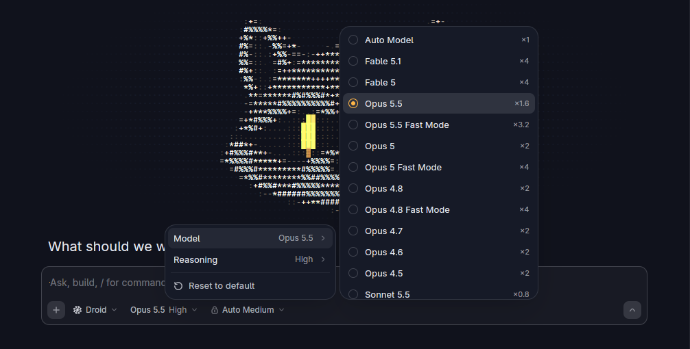

# Arakun

A native desktop app for working with coding agents, written in Rust with
[GPUI](https://github.com/zed-industries/zed/tree/main/crates/gpui). It keeps your
projects, their git worktrees, agent sessions, terminals, a browser and GitHub CI in one
window, and exposes the same workspace to the agents through a command line.



## Features

- **Projects and worktrees.** A rail of projects, each with its environments (the main
  checkout plus git worktrees). Every environment has its own tabs, sessions, terminals
  and draft prompt. The Workspace panel shows Sessions, an Explorer and the uncommitted
  Changes; the Branches tab draws every live branch against the default one.
- **Agent sessions.** Claude Code (through the ACP adapter
  `@agentclientprotocol/claude-agent-acp`), Factory's Droid, OpenCode, and Cloudflare
  Workers AI (a tool loop Arakun runs itself against the Workers AI API). Transcripts
  render markdown, diffs, tool calls and images; sessions can be resumed, and per-turn
  diffs show what each turn changed, including changes made by shell commands.
- **Project check.** A per-project command (`cargo test`, `npm test`...) runs after each
  turn that edits files; on failure the tail of the output goes back to the agent, up to
  three times in a row. Arakun also notices when an agent loops (the same failing command
  or the same edit over and over) and offers to stop and rethink.
- **Memory.** Agents save what they learn (`arakun mem`), and every new session starts
  with an index of it in the system prompt. Plain JSON files, one per repository plus a
  global one.
- **Terminals.** A dock of terminals per environment (alacritty_terminal; ConPTY on
  Windows), numbered so agents and scripts can read them with `arakun logs`.
- **Built-in browser.** Browser tabs based on CEF (Chromium Embedded Framework), behind
  the optional `browser` cargo feature. Agents can drive pages on localhost through
  `arakun page` (screenshot, console, click, type, eval).
- **GitHub CI and checks.** GitHub Actions runs for each project, with jobs, annotations
  and the failing log, read through the `gh` CLI.
- **Dynamic Island** (Linux/Wayland only for now). A small overlay at the top of the
  screen that shows what the agents of every project are doing: a dot per busy session, a
  card when one finishes, fails or needs an answer. It runs as its own process
  (`arakun island-host`) and needs a compositor with the wlr-layer-shell protocol.
- **Phone remote.** A web page served by Arakun lets a paired phone follow sessions, send
  prompts and answer the agent. Phones reach the computer over the local network (the
  default), over Tailscale, or through an end-to-end encrypted relay. The relay defaults
  to the hosted one at `arakun.dev`; you can run your own from [`relay/`](relay)
  (a Cloudflare Worker) and point `relay_base` in `phone.json` at it.
- **Headless agents.** `arakun agent run` starts an agent in its own process that keeps
  going with the app closed. Its tools run inside a bubblewrap sandbox (workspace
  writable, the rest read-only, no credentials, no network unless `--allow net`), and a
  policy (`--policy readonly|workspace|full`) decides which tool calls need your approval
  (`arakun agent approve|deny`). Linux only (needs `bwrap`); headless runs use Workers AI
  models for now.
- **Service tabs.** A PostHog tab (personal API keys; matches projects by their `phc_`
  keys) and a Cloudflare tab (uses the `cf` CLI's sign-in). Also: Usage (token use and
  cost from Claude Code's and Droid's own logs), Extensions (MCP servers, plugins, skills
  and permission rules of the agents), Automations (scheduled shell commands or agent
  prompts per project), and an Inbox.

## Platform status

| Platform | Status | Notes |
|---|---|---|
| Linux (x86_64) | Supported | Main platform. Wayland and X11. The Dynamic Island needs Wayland with wlr-layer-shell. |
| Windows 10/11 (x86_64) | Beta | No Dynamic Island yet. Release builds do not include the browser yet; build from source with the `browser` feature to get it. See [docs/windows.md](docs/windows.md). |
| macOS | Experimental | Build from source. Untested. |

## Install

Download the archive for your platform from
[GitHub Releases](https://github.com/arakunhq/arakun/releases) and check it against
`SHA256SUMS`. Release builds are built without the browser feature.

Each archive also has a build provenance attestation. It shows that this repository's
release workflow built the archive, and from which commit. Check it with the
[GitHub CLI](https://cli.github.com):

```sh
gh attestation verify arakun-<version>-linux-x86_64.tar.gz -R arakunhq/arakun
```

**Linux:** extract `arakun-<version>-linux-x86_64.tar.gz` and put `arakun` somewhere on
your `PATH`, for example `~/.local/bin`. It needs glibc 2.35 or newer (Ubuntu 22.04+,
Debian 12+, Fedora 36+); on older systems, build from source. You also need a Vulkan
driver and the usual desktop libraries (libxkbcommon, Wayland or X11, fontconfig,
freetype).

**Windows:** extract `arakun-<version>-windows-x86_64.zip` and run `arakun.exe`.

Arakun does not bundle the agents. Install the ones you want to use:

- Claude Code: Node.js with `npm` (Arakun installs the ACP adapter) and a signed-in
  `claude`.
- Droid: Factory's `droid` CLI.
- OpenCode: the `opencode` CLI, signed in with `opencode auth login`.
- Workers AI: a Cloudflare API token with Workers AI access, either stored through
  `opencode auth login` or set as `CLOUDFLARE_API_TOKEN` and `CLOUDFLARE_ACCOUNT_ID`.

Optional tools: `git` (Changes, worktrees, branches), `gh` (CI), `bwrap` (headless
agents), `secret-tool` from libsecret (stored logins on Linux), `tailscale` (phone over
Tailscale), `cf` (Cloudflare tab).

## Build from source

You need a recent stable Rust toolchain ([rustup](https://rustup.rs)).

**Ubuntu / Debian:**

```sh
sudo apt install build-essential pkg-config \
  libxkbcommon-dev libxkbcommon-x11-dev libwayland-dev libx11-xcb-dev libxcb1-dev \
  libfontconfig1-dev libfreetype-dev libvulkan-dev libssl-dev
```

**Arch Linux:**

```sh
sudo pacman -S --needed base-devel pkgconf \
  libxkbcommon libxkbcommon-x11 wayland libxcb fontconfig freetype2 \
  vulkan-icd-loader vulkan-headers openssl
```

**Windows:** MSVC toolchain and Visual Studio Build Tools; see
[docs/windows.md](docs/windows.md).

### Without the browser

The quickest path, and what CI and the release builds use:

```sh
git clone https://github.com/arakunhq/arakun
cd arakun
cargo build --release --no-default-features
./target/release/arakun
```

### With the browser (CEF)

The default `browser` feature needs CEF at build time and at run time.

- **Linux:** download the CEF 156.0.15 linux64 binary distribution (the minimal one is
  enough) from <https://cef-builds.spotifycdn.com/index.html>, unpack it, and run:

  ```sh
  tools/install-cef.sh /path/to/cef_binary_156.0.15_linux64
  cargo build --release
  ```

  This puts the runtime in `~/.local/share/arakun/cef` (loaded on the first browser tab)
  and links the build-time SDK at `.cef-sdk`, which `.cargo/config.toml` points `CEF_PATH`
  at.
- **Windows and macOS:** the first build downloads CEF into `.cef-sdk` by itself. On
  Windows it also needs CMake and Ninja; see [docs/windows.md](docs/windows.md).

### Install for your user (Linux)

`tools/install.sh` builds a release binary and installs it to `~/.local/bin`, with a
`.desktop` entry and icons. It prepares CEF with `tools/install-cef.sh` if it is missing
and `CEF_DIST` points at an unpacked distribution.

```sh
tools/install.sh               # --no-browser, --prefix DIR, --uninstall
```

## Command line

While Arakun is running, `arakun <command>` acts on the environment of the current
directory, over a local control socket (`$XDG_RUNTIME_DIR/arakun/control.sock`, or
`%LOCALAPPDATA%\arakun\control.sock` on Windows). Terminals and agents started by Arakun
get `ARAKUN_SOCKET` and `arakun` on their `PATH`, and the agents get a note in their
system prompt about it (`ARAKUN_AGENT_HINT=off` removes it).

```sh
arakun .                          # add this project (or switch to it); starts Arakun if needed
arakun browse -s localhost:3000   # open a page in the side pane
arakun open -s src/main.rs:42     # open a file in the side pane at line 42
arakun run --port 5173 npm run dev   # new terminal; wait until the port answers
arakun logs 2 --until compiled    # wait until terminal 2 prints "compiled"
arakun check                      # run the project check here
arakun page screenshot            # PNG of the environment's browser tab
arakun notify "done"              # desktop notification
arakun ls                         # projects, environments and sessions
arakun mem search <words>         # search what agents remember about this project
arakun agent run <prompt>         # start a headless agent
```

`arakun run` and `arakun logs` take `--ready <text>`, `--port <n>` and `--timeout <s>`
before the command, and fail with the tail of the output if the command exits or times
out first.

## Keyboard shortcuts

- `Ctrl+T` new session, `Ctrl+J` toggle the terminal dock, `Ctrl+B` toggle the sidebar
- `Ctrl+D` / `Ctrl+Shift+D` split right / down, `Ctrl+Alt+arrows` move between panes
- `Ctrl+Tab`, `Ctrl+1...9` switch tabs; `Alt+Up` / `Alt+Down` switch environments
- `Ctrl+F` search the conversation
- `Ctrl+=` / `Ctrl+-` / `Ctrl+0` zoom the whole interface (in a browser tab, the page)
- In the composer: `Enter` sends, `Shift+Enter` new line, `Up` on an empty composer
  recalls earlier prompts; paste or drop images to attach them

## Contributing

See [CONTRIBUTING.md](CONTRIBUTING.md). Contributors sign the [CLA](CLA.md) on their
first pull request. Security issues: see [SECURITY.md](SECURITY.md).

## License

Arakun is free software under the [GNU Affero General Public License v3.0](LICENSE)
(AGPL-3.0-only). Commercial licenses are available from the copyright holder
(Karlo Aldrete). Contributions require signing the [CLA](CLA.md); see
[CONTRIBUTING.md](CONTRIBUTING.md). Third-party notices are in [NOTICE](NOTICE).
