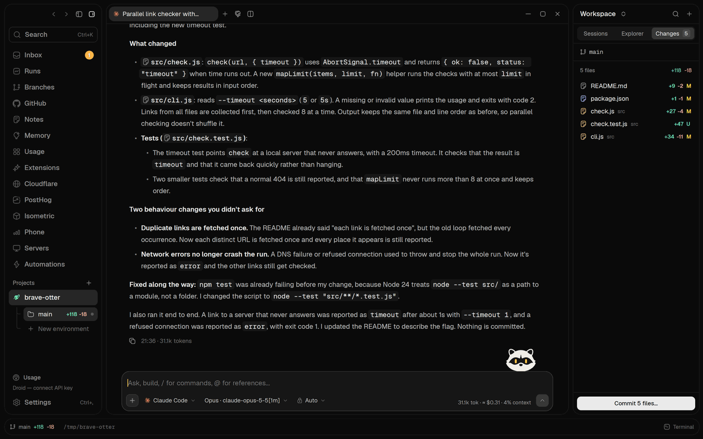

<div align="center">


# Arakun

**One native window for your coding agents.**

Projects, git worktrees, agent sessions, terminals, a browser and GitHub, side by side.<br>
Written in Rust with [GPUI](https://github.com/zed-industries/zed/tree/main/crates/gpui).

[](https://github.com/ArakunHQ/arakun/actions/workflows/ci.yml?query=branch%3Amain)
[](https://github.com/ArakunHQ/arakun/releases/latest)
[](LICENSE)
[](rust-toolchain.toml)
<br>
[](#platforms)
[](docs/windows.md)
[](#platforms)
[](https://www.conventionalcommits.org)

[**Install**](#install) ·
[**Features**](#features) ·
[**Command line**](#command-line) ·
[**Shortcuts**](docs/shortcuts.md) ·
[**Docs**](#docs) ·
[**Contributing**](#contributing)

<picture>
  <source media="(prefers-color-scheme: light)" srcset="docs/screenshots/hero-light.png">
  
</picture>

</div>

## Why Arakun

- **Many agents, one place.** Claude Code, Droid, OpenCode, Codex, Devin, Cursor, Antigravity and Workers AI
  sessions side by side. Give each task its own git worktree so the agents don't step on each
  other.
- **The agents can use the app.** The `arakun` command line lets an agent open pages,
  read terminals, run the project check and leave you GitHub review drafts.
- **Know what they are doing.** A Dynamic Island, an Inbox and a phone remote tell you
  when a session finishes, fails or needs an answer.
- **Native and fast.** A GPU-rendered Rust app, not a web view, with a keyboard-first
  palette for everything.

```sh
curl -fsSL https://arakun.dev/install | sh      # macOS (Apple silicon) and Linux
```

Windows and other options: see [Install](#install).

## Install

**macOS (Apple silicon) and Linux (x86_64 and arm64):**

```sh
curl -fsSL https://arakun.dev/install | sh
```

**Windows (PowerShell):**

```powershell
irm https://arakun.dev/install.ps1 | iex
```

The scripts ([tools/install-release.sh](tools/install-release.sh) and
[tools/install-release.ps1](tools/install-release.ps1)) download the latest release,
check it against `SHA256SUMS` (and its signature, when a verifier is installed; see
[Updates and verification](docs/updates-and-verification.md)), and install it for your user:

| Platform | Installs to | Uninstall |
|---|---|---|
| macOS | `~/Applications/Arakun.app`, linked as `~/.local/bin/arakun` | `rm -rf ~/Applications/Arakun.app ~/.local/bin/arakun` |
| Linux | `~/.local/bin/arakun`, the browser's runtime in `~/.local/share/arakun/cef`, and the app launcher's entry and icon in `~/.local/share/applications/arakun.desktop` and `~/.local/share/icons/hicolor/*/apps/arakun.*` (under `$XDG_DATA_HOME` if set) | `rm -rf ~/.local/bin/arakun ~/.local/share/arakun/cef ~/.local/share/applications/arakun.desktop ~/.local/share/icons/hicolor/*/apps/arakun.*` |
| Windows | `%LOCALAPPDATA%\Programs\Arakun`, added to your user `PATH`, and a Start menu shortcut | delete that folder and the shortcut, and remove it from `PATH` |

To install a given version, run `curl -fsSL https://arakun.dev/install | sh -s -- --version v0.2.1`,
or set `ARAKUN_VERSION=v0.2.1` (on Windows, `$env:ARAKUN_VERSION = "v0.2.1"`). There is
no build for Intel Macs yet; [build from source](docs/building.md) there. `v0.1.0` has no macOS build; on
macOS, install a later version. Linux on arm64 has release builds from the release after
v0.4.1. `--nightly` (`ARAKUN_VERSION=nightly`, on Windows `$env:ARAKUN_VERSION = "nightly"`)
installs the newest [nightly build](docs/updates-and-verification.md#nightly-builds) instead, and `--version` takes a
nightly's tag, such as `0.5.1-nightly.202611180300`.

**The server alone (Linux):** on a machine with no display, such as a VPS,
`curl -fsSL https://arakun.dev/install-server | sh` installs only the server. See
[Server](docs/server.md#install-on-a-machine-without-a-display).

A release build updates itself, and installs the update when you quit Arakun. Settings ›
General › Updates turns that off. Releases are signed: see
[Updates and verification](docs/updates-and-verification.md) to check one by hand, or for
nightly builds.

## Requirements

After you install, run `arakun doctor`. It checks everything below on your computer
(the agents and their sign-ins, Node.js, `git`, `gh`, `bwrap`, the browser tabs and the
graphics driver) and prints the command that fixes each thing that is missing.

### Platforms

| Platform | Status | Notes |
|---|---|---|
| Linux (x86_64) | Supported | Main platform. Wayland and X11. The Dynamic Island needs Wayland with wlr-layer-shell. |
| Linux (arm64) | Beta | The same build as x86_64, for ARM machines such as Snapdragon laptops, Ampere and Graviton servers. Less tested. |
| Windows 10/11 (x86_64) | Beta | Browser tabs are barely tested. See [docs/windows.md](docs/windows.md). |
| macOS | Experimental | Release builds for Apple silicon. Little tested, browser tabs least of all. The Dynamic Island's shape around a notch and around the MacBook Pro's own Dynamic Island is not tested on those screens yet. |

### On Linux

- glibc 2.35 or newer (Ubuntu 22.04+, Debian 12+, Fedora 36+). On older systems,
  [build from source](docs/building.md).
- A Vulkan driver. Without a GPU, Mesa's software driver works, only slower
  (`mesa-vulkan-drivers` on Debian, Ubuntu and Fedora, `vulkan-swrast` on Arch).
- A Wayland or X11 desktop. On a machine without one, run [`arakun server`](docs/server.md).
- A Secret Service, such as gnome-keyring, KWallet or KeePassXC, for stored logins.
- On Ubuntu 23.10 and later, browser tabs need an
  [AppArmor profile](docs/browser.md#browser-tabs-on-ubuntu).

### Agents

Arakun does not bundle the agents. Install the ones you want to use:

| Agent | What it needs |
|---|---|
| Claude Code | Node.js with `npm`, and a `claude` that is signed in or has an API key |
| Codex | Node.js with `npm`, and `codex login` or `CODEX_API_KEY` / `OPENAI_API_KEY` |
| Droid | Factory's `droid` CLI |
| OpenCode | The `opencode` CLI, signed in with `opencode auth login` |
| Devin | The [Devin CLI](https://docs.devin.ai/work-with-devin/devin-cli), signed in with `devin auth login` |
| Cursor | The [Cursor CLI](https://cursor.com/docs/cli/installation), signed in with `cursor-agent login` |
| Antigravity | Google's [Antigravity CLI](https://antigravity.google/docs/install?tab=cli) 1.5 or later, signed in with Google |
| Cloudflare Workers AI | A Cloudflare API token with Workers AI access |

For Claude Code and Codex, the first session asks before it installs the ACP adapter
with `npm`. Settings has a page per agent that signs it in. See
[What each agent needs](docs/features.md#what-each-agent-needs) for the details.

Optional tools: `git` (changes, worktrees, branches), `gh` (CI and the GitHub tab),
`bwrap` (sandboxed and headless agents on Linux), `tailscale` (phone over Tailscale)
and `cf` (Cloudflare tab).

## A first session

1. Start Arakun. The setup asks for the agent new sessions use, your first project, a
   color scheme, GitHub, a phone and crash reports. You can skip every step.
2. Press `Ctrl+T` (`Cmd+T` on macOS) for a new session, and write what you want done.
3. Send it. The session gets its own git worktree and branch, so other sessions don't
   touch its files.
4. Watch the agent work. The sidebar marks the session when it finishes, fails or
   needs an answer, and so do the Dynamic Island and your phone.
5. Read what it changed in the Changes tab of the Workspace panel. Its pull request
   chip creates the pull request.

`Ctrl+K` opens the palette: every project, session and command is there.

## Features

See [Features](docs/features.md) for all of it.

- **Sessions in the sidebar**, each in its own git worktree, with its state as a mark. The ones that need you go to the top, and finished ones fold away.
- **Eight agents**: Claude Code, Droid, OpenCode, Codex, Devin, Cursor, Antigravity and Workers AI.
- **Project check**: your tests run after each turn that edits files, and failures go back to the agent.
- **Memory**: agents keep what they learn about a project across sessions.
- **Secrets on a card**: an agent asks for a token or password, and never sees the value.
- **Terminals** per environment, which agents can read with `arakun logs`.
- **Browser tabs** that agents can drive on localhost, or on any page once you allow it in Settings › Privacy ([Browser tabs](docs/browser.md)).
- **GitHub tab**: CI, pull requests, reviews and issues, with agents that fix conflicts, checks and comments.
- **Pull request agent**: connect [arakun-pilot](docs/github-pilot.md) and its board fills the GitHub tab.
- **Dynamic Island**: a small overlay that shows what every agent is doing.
- **Phone remote**: follow and answer sessions from your phone, end-to-end encrypted.
- **Headless and sandboxed agents** that keep going with the app closed ([details](docs/headless.md)).
- **Server**: run sessions on another machine and reach them from anywhere ([Server](docs/server.md)).
- **Linear, PostHog, Cloudflare and Doop tabs**, and a Usage tab for tokens and plan limits.
- **Customize**: color schemes, shapes and the sidebar's layout.
- **Redacted mode** for streams and screen sharing ([Privacy](docs/privacy.md)).

## Command line

While Arakun runs, `arakun <command>` acts on the environment of the current folder.
Terminals and agents that Arakun starts have it on their `PATH`. These are the commands
used most; [Command line](docs/cli.md) lists them all.

```sh
arakun .                          # add this project (or switch to it); starts Arakun if needed
arakun browse -s localhost:3000   # open a page in the side pane
arakun open -s src/main.rs:42     # open a file in the side pane at line 42
arakun run --port 5173 npm run dev   # new terminal; wait until the port answers
arakun logs 2 --until compiled    # wait until terminal 2 prints "compiled"
arakun check                      # run the project check here
arakun page screenshot            # PNG of the environment's browser tab
arakun notify "done"              # desktop notification
arakun ls                         # projects, environments and sessions
arakun doctor                     # what is missing on this computer, and how to fix it
arakun server serve               # run sessions on this machine without the window
```

## Docs

| | |
|---|---|
| [Features](docs/features.md) | Everything Arakun does, view by view |
| [Command line](docs/cli.md) | Every `arakun` command |
| [Keyboard shortcuts](docs/shortcuts.md) | Every shortcut |
| [Server](docs/server.md) | `arakun server`: sessions on another machine |
| [Headless and sandboxed agents](docs/headless.md) | Agents without the window, and what the sandbox hides |
| [arakun-pilot](docs/github-pilot.md) | The pull request agent in the GitHub tab |
| [Browser tabs](docs/browser.md) | CEF, driving pages, AppArmor on Ubuntu |
| [Privacy](docs/privacy.md) | Hidden secrets, redacted mode, crash reports and usage counts |
| [Updates and verification](docs/updates-and-verification.md) | The updater, nightly builds, signatures |
| [Storage and environment variables](docs/storage-and-env.md) | Every file Arakun keeps, and every variable it reads |
| [Build from source](docs/building.md) | Building the app, the server and the phone page |
| [Windows](docs/windows.md) | What is different on Windows |

## Contributing

Contributions are welcome. Read [CONTRIBUTING.md](CONTRIBUTING.md) first: it covers
setup (`tools/setup-dev.sh`), the checks CI runs, and the Conventional Commits titles
pull requests need. Contributors sign the [CLA](CLA.md) on their first pull request.
Please follow the [Code of Conduct](CODE_OF_CONDUCT.md). Report security issues as
[SECURITY.md](SECURITY.md) says, not in public issues.

## License

Arakun is free software under the [GNU Affero General Public License v3.0](LICENSE)
(AGPL-3.0-only). Commercial licenses are available from the copyright holder
(Karlo Aldrete). Contributions require signing the [CLA](CLA.md); see
[CONTRIBUTING.md](CONTRIBUTING.md). Third-party notices are in [NOTICE](NOTICE).

Arakun's cloud in [`cloud/`](cloud/) (the cloud Worker with the relay and sign-in,
the admin panel and the cloud machine container image) has its own license, the
[PolyForm Noncommercial License 1.0.0](cloud/LICENSE): you may use, change and share
it for noncommercial purposes, and only Arakun may sell it or offer it as a paid or
hosted service. The app, `arakun-server` and the phone page stay AGPL-3.0.

<div align="center">
<br>

<br>
<sub>Made with Rust and a raccoon. <a href="https://arakun.dev">arakun.dev</a></sub>
</div>
