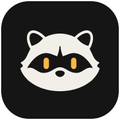
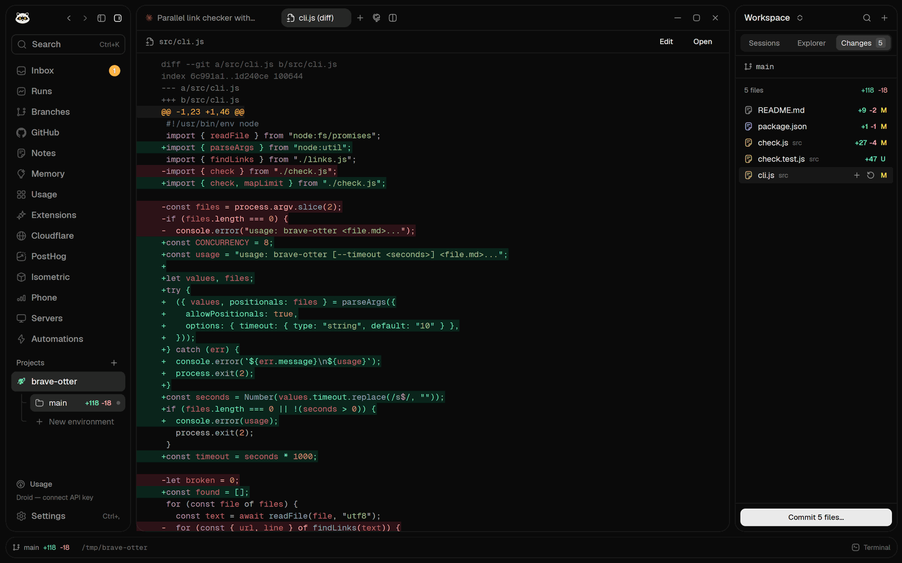
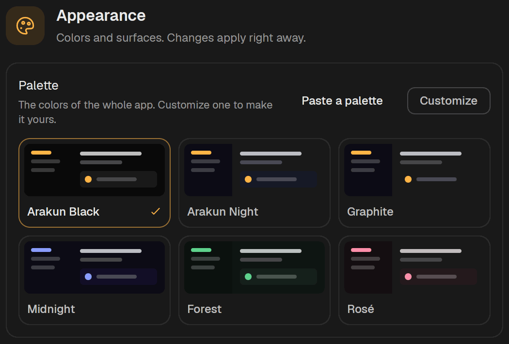

<div align="center">



# Arakun

**One native window for your coding agents.**

Projects, git worktrees, agent sessions, terminals, a browser and GitHub, side by side.<br>
Written in Rust with [GPUI](https://github.com/zed-industries/zed/tree/main/crates/gpui).

[](https://github.com/ArakunHQ/arakun/actions/workflows/ci.yml?query=branch%3Amain)
[](https://github.com/ArakunHQ/arakun/releases/latest)
[](LICENSE)
[](rust-toolchain.toml)
<br>
[](#platform-status)
[](docs/windows.md)
[](#platform-status)
[](https://www.conventionalcommits.org)

[**Install**](#install) ·
[**Features**](#features) ·
[**Command line**](#command-line) ·
[**Shortcuts**](#keyboard-shortcuts) ·
[**Build from source**](#build-from-source) ·
[**Contributing**](#contributing)

<picture>
  <source media="(prefers-color-scheme: light)" srcset="docs/screenshots/hero-light.png">
  
</picture>

</div>

## Why Arakun

- **Many agents, one place.** Claude Code, Droid, OpenCode, Codex and Workers AI
  sessions side by side. Give each task its own git worktree so the agents don't step on each
  other.
- **The agents can use the app.** The `arakun` command line lets an agent open pages,
  read terminals, run the project check and leave you GitHub review drafts.
- **Know what they are doing.** A Dynamic Island, an Inbox and a phone remote tell you
  when a session finishes, fails or needs an answer.
- **Native and fast.** A GPU-rendered Rust app, not a web view, with a keyboard-first
  palette for everything.

```sh
curl -fsSL https://arakun.dev/install | sh      # macOS (Apple silicon) and Linux
```

Windows and other options: see [Install](#install).

## Features

### First launch

Before you have a project, Arakun walks you through a short setup: which agents it
found and the one to start with, dark or light and five shortcuts, GitHub and the phone
remote, the question about crash reports, and your first project. Every step can be
skipped, and "Skip setup" leaves it at once. Adding a project ends it. Open it again
with "Show onboarding" in the palette (`Ctrl+K`). That it was done is kept in
`state.onboarding.json`, next to `state.json` in Arakun's data folder.

### Workspace

- **Projects and worktrees.** A rail of projects, each with its environments (the main
  checkout plus git worktrees). The default sidebar shows the open project, with the
  others in its dropdown, and its environments as a flat list: a status dot, the name,
  and one signal (Needs you, CI failed, or the diff). The **+** on Environments, or
  `Ctrl+Shift+N`, makes an environment at once on a random branch from the current
  commit; `Alt`+click on it, or File › New Environment with Options…, asks for the
  branch and where to start from. Every environment has its own tabs, sessions, terminals
  and draft prompt. The Workspace panel shows Sessions, an Explorer and the uncommitted
  Changes; the Branches tab draws every live branch against the default one.

  
- **Add or clone a project.** "Add project" (`Ctrl+O`) searches the git repositories
  in your home folder, or browses a path you type (`~/code/`). Paste a clone URL
  (`https://github.com/o/r`, `git@host:o/r.git`, a `gh repo clone o/r` or `git clone …`
  line) or type a GitHub `o/r` to clone it and add it in one step. GitHub repositories
  are cloned with `gh` when it is installed, so private ones use its sign-in. The clone
  goes in the folder that already holds most of your repositories, or `~/code`.
- **Branch names from the task.** A new environment starts on a random branch name
  (`env/brave-otter`); after the first prompt, a small model names it after the task
  (`fix/terminal-tab-name`) and Arakun renames the branch. The folder keeps its name. By
  default the agent the prompt went to names it, when that is Claude Code (with `haiku`)
  or Droid, so the prompt goes nowhere else; other agents leave the name alone.
  Settings › Branches can pick Claude Code or Droid for every environment, or turn naming
  off; it saves that in `~/.local/share/arakun/branch-namer.json`
  (`%LOCALAPPDATA%\arakun\branch-namer.json` on Windows).
- **Settled after merge.** Once an environment's pull request is merged (Arakun asks
  `gh` every few minutes), its open review threads are resolved on GitHub, its
  notifications are marked read, and the environment's sessions from before the merge
  stop asking for you; agents that are idle and not open in a tab stop. The GitHub tab
  also marks read the notifications of every merged pull request it reads. Each merge is
  settled once, within a week of it; threads that fail to resolve are tried again at the
  next few checks. Settled merges are noted in `~/.local/share/arakun/settled.json`.
  On by default; turn off Settings › Branches › Settle threads after merge (saved in
  `~/.local/share/arakun/settle-after-merge`, `%LOCALAPPDATA%\arakun\` on Windows).
- **Terminals.** A dock of terminals per environment (alacritty_terminal; ConPTY on
  Windows), numbered so agents and scripts can read them with `arakun logs`.
- **Built-in browser.** Browser tabs based on CEF (Chromium Embedded Framework), behind
  the optional `browser` cargo feature. Agents can drive pages on localhost through
  `arakun page` (screenshot, console, click, type, eval). Links you click open in a
  browser tab; turn off Settings › General › Open links in Arakun to open them in your
  own browser instead. That covers links from chats, the GitHub view and pins; a link
  clicked inside a browser tab always stays in Arakun. Builds without the browser open
  links in your own browser from the start. The choice is
  saved in `~/.local/share/arakun/open-links` (`%LOCALAPPDATA%\arakun\open-links` on
  Windows).

### Agents

| Agent | How Arakun runs it |
|---|---|
| Claude Code | Through the ACP adapter `@agentclientprotocol/claude-agent-acp` |
| Droid | Factory's `droid` CLI |
| OpenCode | The `opencode` CLI |
| Codex | Through the ACP adapter `@agentclientprotocol/codex-acp`, which brings its own `codex` |
| Cloudflare Workers AI | A tool loop Arakun runs itself against the Workers AI API |

The Claude Code adapter runs the Claude Code binary bundled with it (the `claude` on
your `PATH` only when that one is missing; `CLAUDE_CODE_EXECUTABLE` picks another), so
its version can differ from the `claude` in your terminal. It loads your user, project
and local settings, so your skills, hooks, plugins, MCP servers, `CLAUDE.md` and
permission rules work as they do in the terminal. It leaves out commands that only make
sense in the terminal app: `/clear`, `/cost`, `/keybindings-help`, `/login`, `/logout`,
`/output-style:new`, `/release-notes`, `/todos` and others Claude Code marks as
terminal-only. The status line and keybindings from your settings don't apply in Arakun.

- **Agent sessions.** Transcripts render markdown, diffs, tool calls and images;
  sessions can be resumed, and per-turn diffs show what each turn changed, including
  changes made by shell commands.
- **Project check.** A per-project command (`cargo test`, `npm test`...) runs after each
  turn that edits files; on failure the tail of the output goes back to the agent, up to
  three times in a row. Checks run one at a time across all sessions, at low priority and
  with half the cores for builds (`CARGO_BUILD_JOBS`), so several agents finishing
  together don't stall the computer. Arakun also notices when an agent loops (the same
  failing command or the same edit over and over) and offers to stop and rethink.
- **Memory.** Agents save what they learn (`arakun mem`), and every new session starts
  with an index of it in the system prompt. Plain JSON files, one per repository plus a
  global one.
- **Headless agents.** `arakun agent run` starts an agent in its own process that keeps
  going with the app closed. Its tools run inside a bubblewrap sandbox (workspace
  writable, the rest read-only, no credentials, no network unless `--allow net`), and a
  policy (`--policy readonly|workspace|full`) decides which tool calls need your approval
  (`arakun agent approve|deny`). Linux only (needs `bwrap`); headless runs use Workers AI
  models for now.
- **Server.** `arakun server serve` is Arakun without a window, for a machine nobody
  sits at: a build box, the workstation at the office, a VPS. It runs sessions of any
  agent signed in on that machine and keeps them going while nothing is connected.
  Paired devices reach it the way phones reach the app, with the same page, pairing
  and notifications, and the app follows them in its Servers tab; agents ask for
  permission as they do in the app, and you answer from wherever you are.
  `arakun-server` is the same server as a program of its own that needs no display
  library. See [Server](#server).

### GitHub

- **CI and checks.** GitHub Actions runs for each project, with jobs, annotations and
  the failing log, read through the `gh` CLI.
- **Queue.** The GitHub tab opens on one line that says how many things need you,
  then a quiet list grouped by where each pull request stands (Needs you, Stuck,
  pilot is on it, Waiting on CI, Waiting on others, Ready to merge), stacked pull
  requests under their base, and what was merged today folded at the bottom. With
  arakun-pilot (below) the list is its board; without it, the review queue: pull
  requests whose review is asked of you, mentions and assignments, your own open pull
  requests, what is ready to merge and what was done today, read from your
  notifications and searches through the `gh` CLI and its session. It opens before you
  add a project too.
- **Pull request sheet.** A row opens a sheet on the right with where the pull request
  stands, who has it, what comes next, the checks and the stack, then tabs for what
  pilot did, the conversation, checks and files. On a window under 1000 pixels tall the
  details fold to one line (status, checks, review and merge) so the tabs keep the room;
  "All details" (`D`) unfolds them and "Fewer details" folds them again, and the choice
  stays for the next pull request. The box at the bottom comments (Enter
  or "Comment"), and says why when a comment doesn't go out. Approve, request changes
  and merge ask a second time, and an approval or a merge stops if new commits came
  after you looked.
- **Agent reviews.** An agent can review a pull request for you and leave a draft
  (`arakun github draft`) that you post, edit or discard. Posting a draft asks a second
  time, and an approval goes out only for the commit the agent read: after new commits
  the draft can only be posted as a comment.
- **Alerts and filters.** Review requests, mentions and assignments raise an alert; so
  does anything new in the organizations and repositories on your watch list. Click the
  repository line above the verdict to show only some organizations or repositories; the rest
  doesn't show, count or alert. "Mark all read" marks only what that choice shows.
- **Pull request agent.** With a pull request agent on a server of your own
  (arakun-pilot), `~/.config/arakun-pilot/client.json` (`$XDG_CONFIG_HOME` when set to an absolute path;
  `{"url": "…", "token": "…"}`) turns it on, and Arakun reads `GET <url>/board` and
  `GET <url>/items` every minute. A test Arakun with `ARAKUN_STATE` set, as `arakun dev`
  starts one, reads `arakun-pilot/client.json` in the folder of that state file instead.
  The `url` must be `https://`; plain `http://` works only for `localhost`, `127.0.0.1`
  and `[::1]`, so the tokens never cross a network unencrypted. The board fills the
  queue; the rows pilot doesn't follow fold under "More on GitHub". When pilot
  asks you something, the sheet shows the question with one button per answer and
  "Other answer…" for your own words ("Answer…" when there are no ready answers;
  `POST <url>/items/<id>/answer`), and the notice in
  the island opens that sheet over whatever window is in front (Esc gives it back).
  Without a board, the notice opens the pull request's sheet, which doesn't show the
  question: answer it on pilot's card in the queue. On your own pull requests, "Ask pilot" in the sheet sends what you
  typed as a task (`POST <url>/tasks`, which needs `"admin_token"` in `client.json`).
  While the Worker has no board, its cards show at the top of the queue under "Your
  agent". With a board, a card about a pull request the board follows shows under
  "From pilot" in that pull request's sheet, and the rest in a "From pilot" group at the
  top of the queue. "Looks good" approves the commit pilot read, and both it and
  request changes go through the same second click. What you saw and dealt with is
  kept in `~/.local/share/arakun/pilot.json` (`%LOCALAPPDATA%\arakun\pilot.json` on
  Windows; next to the state file when `ARAKUN_STATE` is set). Ctrl+K "Send to the cloud agent…" (or type
  `cloud: <task>`) hands it new work, on the open pull request of yours picked in the tab
  or on a new branch (`POST <url>/tasks`); that needs `"admin_token"` in `client.json`
  too. On that card `Tab` switches between your pull request and a new branch (see
  [Keyboard shortcuts](#keyboard-shortcuts)).

<details>
<summary>When the GitHub tab reads GitHub, and what it stores</summary>

Arakun reads GitHub in the background only after you open the tab once, and stops while
`gh` is missing or signed out. It keeps the watch list, the filter choice and whether you
opened the tab in `github.json` next to its state, drafts in `github/drafts/` beside
them, and the profile pictures it shows in `github/avatars/` (each downloaded again
after a week).

</details>

### Stay in the loop

- **Dynamic Island** (Linux on Wayland, and macOS). A small overlay at the top of the
  screen that shows what the agents of every project are doing: a dot per busy session, a
  card when one finishes, fails or needs an answer. It runs as its own process
  (`arakun island-host`). On Linux it needs a compositor with the wlr-layer-shell
  protocol. On a MacBook it grows out of the notch, or out of the screen's own Dynamic
  Island on the models that have one, and sits on the built-in screen. On a Mac without
  either it hangs from the top of the main screen. Turning it off in Settings ends that
  process. If it reads the cutout wrong, set
  `ARAKUN_ISLAND_EDGE` to `flat`, `notch:<width>x<height>` or
  `pill:<width>x<height>+<gap to the top>`, in points.
- **Notification history.** Every notice Arakun shows (on the island or as a desktop
  notification) also lands in the sidebar's Inbox, under the sessions waiting on you,
  grouped by day. Click one to open what it is about. The Inbox is the button at the end
  of the search box when it sits next to Search in the sidebar (as in every preset), and
  a row of its own anywhere else. Its badge counts the unread ones (9+ past nine); they
  count as read when you close it. Arakun keeps the last 300 in
  `notices.json` next to its state. `arakun notices [--unseen]` prints them.
- **Phone remote.** A web page served by Arakun lets a paired phone follow sessions, send
  prompts and answer the agent. Phones reach the computer over the local network (the
  default), over Tailscale, or through an end-to-end encrypted relay. The relay defaults
  to the hosted one at `arakun.dev`; you can run your own from [`relay/`](relay)
  (a Cloudflare Worker) and point `relay_base` in `phone.json` at it.

### More tabs

- **Service tabs.** A PostHog tab (personal API keys; matches projects by their `phc_`
  keys) and a Cloudflare tab (uses the `cf` CLI's sign-in).
- **Usage.** Token use and cost from Claude Code's and Droid's own logs, and each plan's
  limits. Arakun has no account of its own and never asks you to approve access: it
  reads the limits with the sign-in each CLI already has (Claude Code, droid,
  OpenCode), and Sign in runs the CLI's own login. It only reads that sign-in and
  never changes it. It sends it only to that provider's own host over https, never to
  a gateway set in `ANTHROPIC_BASE_URL`. Droid can also use a Factory API key you
  connect in Arakun (kept in the system keyring) or `FACTORY_API_KEY`, which goes only
  to api.factory.ai. When Claude Code runs on CLIProxyAPI, add the proxy's management key in the
  tab to see the 5-hour and weekly limits of every claude.ai account behind it. The
  key is only sent to the proxy it was added for, over https or to this machine. It is
  saved in `~/.local/share/arakun/cliproxy-management-key`, and the last limits read
  in `cliproxy-plan.json` next to it.
- **Marketplace.** Plugins and MCP servers to add, and the MCP servers, plugins, skills
  and permission rules the agents load now. Under Arakun › Extensions you turn on the
  tabs the sidebar shows besides Inbox, Runs, Branches and Marketplace: GitHub, Notes,
  Memory, Usage, Cloudflare, PostHog, Isometric, Phone, Servers and Automations. A new
  install starts with none on; an update keeps the ones your sidebar already had. The
  choice is kept in `extensions.json` next to the state.
- **Automations.** Scheduled shell commands or agent prompts per project.

### Make it yours

- **Color palettes.** Settings › Appearance has built-in palettes (Arakun Black, the
  default, then Calma, Arakun Night, Graphite, Midnight, Forest, Rosé). Only the center
  of the window is a sheet; the sidebar, the workspace panel and the status line sit on
  the window itself, and the accent is kept for what needs you. Customize one to change
  its tint, background and accent; Arakun warns when text or the accent gets hard to
  read. A palette fits in one line (`arakun:palette/v1:…`) that anyone can paste there to
  get it. The choice and your palettes are kept in `palettes.json` next to the state.

  
- **Dark and light.** Settings › Appearance › Mode draws the palette on black or on a
  white background with dark text. The choice is kept in `palettes.json`.
- **Corners and spacing.** Settings › Appearance also sets the shape of the whole app,
  live. Corners makes cards, buttons and fields sharper or rounder (0 to 200%; presets
  Sharp, Default, Round). Spacing makes the room inside and between things tighter or
  roomier (60 to 160%; Compact, Default, Roomy). Window gap is the space around and
  between the sidebar, the main area, the panel and the dock (0 to 20 px; None, Default,
  Wide). The defaults (100%, 100%, 8 px) look as before. These are kept in
  `palettes.json` too.

### Redacted mode

For streams, demos and screen sharing. `Ctrl+Shift+H`, the palette or Settings › Privacy
turns it on; a "Redacted" pill in the title bar shows it is on, and a click on it turns it
off. While it is on, Arakun hides:

- account emails and names: the Cloudflare and PostHog accounts, the claude.ai accounts
  behind CLIProxyAPI, your git name and email in the sidebar, Cloudflare's audit log;
- the phone's pairing QR code and code, its addresses and the names of paired phones
  ("Copy link" still copies the real link);
- the host Claude Code runs on, a server's pairing link, and IP addresses;
- in terminals, agent replies, tool output, tab titles, notifications and the Inbox:
  emails, values shaped like keys or tokens (`sk-…`, `ghp_…` and long random words keep
  their first four characters), the value after a name such as `API_KEY=` or `token:`,
  the word after `Bearer`, IPv4 addresses other than `127.0.0.1`, and your user name
  and the computer's name, as a shell prompt shows them (`you@laptop`).

It works on what it can recognize, so check a view before you share it: a secret that
looks like a plain word still shows. The choice is kept in a `redacted` file in Arakun's
data folder, so it is still on after a restart. `ARAKUN_REDACTED=1` turns it on for one
run without changing that file.

### Usage and crash reports

Arakun sends nothing until you say so. On first launch it asks whether to send crash
reports and anonymous usage counts to Arakun's PostHog project, so we can see what
breaks and what gets used: as a step of the setup, or in a dialog when you skip the
setup or already have a project. Settings › Privacy has a switch for each:

- **Crash reports:** a panic's message and stack trace, and when an agent stops with
  an error, the agent's name and a fixed category such as "rate limited" or "not
  signed in", never the error's text.
- **Usage counts:** app launched, app quit (with the minutes it was open), setup
  finished (whether you added a project or skipped, and the step you were on),
  session started (with the agent), agent turn finished (with the agent, how it
  stopped and how many seconds it took), project added, environment created, a
  built-in view opened (with its name) and a browser tab opened.

Each event carries Arakun's version, the OS and the CPU architecture. On first launch,
what happens before you answer the question waits in memory: it is sent if you turn
usage counts on, and dropped if you don't. Arakun never
sends prompts, replies or file contents. A panic's message is the one text that is
sent: before it leaves your machine, Arakun replaces your home folder with `~` and
removes paths, links, emails and anything shaped like a key or token. Its other words
are sent as they are, so a crash message can still name something it was working on. Events carry a random id kept in
`telemetry-id` in Arakun's data folder (`~/.local/share/arakun` on Linux and macOS,
`%LOCALAPPDATA%\arakun` on Windows); it is not tied to any account, PostHog makes no
person profile from it and no location from your IP, and deleting the file starts a
new one. Your answer is kept in `telemetry.json` in the same folder.

`DO_NOT_TRACK=1` or `ARAKUN_TELEMETRY=0` turn both off and skip the question;
`ARAKUN_TELEMETRY=1` turns both on. Debug builds send nothing unless
`ARAKUN_TELEMETRY=1` is set, and the test Arakun of `arakun dev` never does. A build
made with `ARAKUN_POSTHOG_KEY=` (empty) sends nothing at all.

## Platform status

| Platform | Status | Notes |
|---|---|---|
| Linux (x86_64) | Supported | Main platform. Wayland and X11. The Dynamic Island needs Wayland with wlr-layer-shell. |
| Windows 10/11 (x86_64) | Beta | No Dynamic Island yet. Browser tabs are barely tested. See [docs/windows.md](docs/windows.md). |
| macOS | Experimental | Release builds for Apple silicon. Little tested, browser tabs least of all. The Dynamic Island's shape around a notch and around the MacBook Pro's own Dynamic Island is not tested on those screens yet. |

## Install

**macOS (Apple silicon) and Linux (x86_64):**

```sh
curl -fsSL https://arakun.dev/install | sh
```

**Windows (PowerShell):**

```powershell
irm https://arakun.dev/install.ps1 | iex
```

The scripts ([tools/install-release.sh](tools/install-release.sh) and
[tools/install-release.ps1](tools/install-release.ps1)) download the latest release,
check it against `SHA256SUMS` (and its signature, when a verifier is installed; see
[Updates](#updates)), and install it for your user:

| Platform | Installs to | Uninstall |
|---|---|---|
| macOS | `~/Applications/Arakun.app`, linked as `~/.local/bin/arakun` | `rm -rf ~/Applications/Arakun.app ~/.local/bin/arakun` |
| Linux | `~/.local/bin/arakun`, and the browser's runtime in `~/.local/share/arakun/cef` (`$XDG_DATA_HOME/arakun/cef` if set) | `rm -rf ~/.local/bin/arakun ~/.local/share/arakun/cef` |
| Windows | `%LOCALAPPDATA%\Programs\Arakun`, added to your user `PATH`, and a Start menu shortcut | delete that folder and the shortcut, and remove it from `PATH` |

To install a given version, run `curl -fsSL https://arakun.dev/install | sh -s -- --version v0.2.1`,
or set `ARAKUN_VERSION=v0.2.1` (on Windows, `$env:ARAKUN_VERSION = "v0.2.1"`). There is
no build for Intel Macs or Linux on ARM yet; build from source there. `v0.1.0` has no
macOS build; on macOS, install a later version.

**The server alone (Linux x86_64):** for a machine with no display, such as a VPS, install
only [`arakun-server`](#the-server-alone-no-display):

```sh
curl -fsSL https://arakun.dev/install-server | sh
curl -fsSL https://arakun.dev/install | sh -s -- --server    # the same
```

It is the install script with `--server`: it checks the release the same way and installs
`~/.local/bin/arakun-server` (uninstall: `rm ~/.local/bin/arakun-server`). It takes
`--version` too. Releases after v0.4.0 carry it. It does not update itself: run the line
again for a new release, then restart the service if it runs as one:
`systemctl --user restart arakun-server`. A server in another folder
(`ARAKUN_SERVER_DIR`) is the unit `arakun-server-<folder>`, and a service installed as
root needs `systemctl` without `--user`.

### Updates

A release build keeps itself up to date. Every 6 hours it asks GitHub for the latest
release. When there is a newer one, it downloads it, checks it against the release's
signed `SHA256SUMS`, and puts it next to the installed app. The update is installed when
you quit Arakun, so the next start runs it. Settings › General › Updates shows the version, has **Check now**,
and on Linux and macOS **Restart now**. Turn **Update automatically** off there to stop
the checks; `ARAKUN_UPDATES=0` turns them off for one run.

From a terminal, `arakun update` downloads the latest release and installs it. If Arakun
is running, it is installed when Arakun quits: on Linux and macOS `arakun restart` does
that now; on Windows, quit Arakun and open it again. `arakun update --check` only says
whether there is a newer release.

The updater keeps its files in Arakun's data folder (`~/.local/share/arakun` on Linux
and macOS, `%LOCALAPPDATA%\arakun` on Windows): `update.json` (the version waiting to be
installed, its checksum, and the last one you were told about), `update.lock` (held while
one updater runs), `no-auto-update` (there while **Update automatically** is off) and
`update-download/` (the download, removed when it is done). The new version waits next to
the installed one as `.arakun.update` (`.Arakun.app.update` on macOS, `.arakun.exe.update`
on Windows), unpacked first as `.arakun.incoming`.

Arakun updates itself where it runs from, so that folder and the binary must be yours
(the install scripts' folders are). A binary that belongs to another user, such as one a
package manager installed, is left alone: update it the way it was installed. A build
from source never updates itself: it has its own way of installing and the browser
runtime it was built against. Pull and build it again instead.

An update replaces the binary (the whole `Arakun.app` on macOS). The browser runtime
(CEF) comes along only when there is none yet, such as on a release from before the
browser. A release with another version of CEF is not installed by the updater, since
Windows keeps a running browser's files locked; it says so, and the install script
installs it once Arakun is closed.

What is checked: `SHA256SUMS` is signed with Arakun's release key, the download matches
the checksum in it, and the new binary starts and says the version it should. The
signature shows the release was made by someone who holds that key, which only the
release workflow can use: someone who can change a release on GitHub but has no key
can't make the updater install anything. A missing or bad signature stops the update.
The public key is built into Arakun and is
[assets/release-key.pub](assets/release-key.pub). A second key, kept offline, is
accepted too ([assets/release-key-backup.pub](assets/release-key-backup.pub)), so
releases can still be signed if the first one is ever lost.

The install scripts check the signature only when a verifier is installed: `minisign`,
or on Linux and macOS also OpenSSL 3 (macOS ships LibreSSL, so there it usually takes
`brew install minisign`). Without one they check only the checksum, and say so.
Releases up to v0.3.0 are not signed. The scripts install one only when you ask for it
with `--version` (`ARAKUN_VERSION` on Windows); an unsigned latest release is refused.

### Manual download

Download the archive or disk image for your platform from
[GitHub Releases](https://github.com/arakunhq/arakun/releases) and check it against
`SHA256SUMS`. Release builds include the browser: each carries CEF (Chromium), a few
hundred MB unpacked. To check that `SHA256SUMS` is signed with Arakun's release key
(releases after v0.3.0), download `SHA256SUMS.minisig` next to it and run
[minisign](https://jedisct1.github.io/minisign/):

```sh
minisign -Vm SHA256SUMS -P RWRHh4aSkL+9oL41eNxaL791lQYzu/un+QvVqfckIj7839aB8lQBoxyn
```

If a release says it is signed with the backup key, check it with that one instead:
`-P RWSxlRjKJX7FQmC0+on+hpDPmZ/ShKCW4KzyJhbnm0bAc6JGTI7KV+xg`.

Each download also has a build provenance attestation. It shows that this repository's
release workflow built it, and from which commit. Check it with the
[GitHub CLI](https://cli.github.com):

```sh
gh attestation verify arakun-<version>-linux-x86_64.tar.gz -R arakunhq/arakun
```

**Linux:** extract `arakun-<version>-linux-x86_64.tar.gz`. `arakun` runs from there, or
put it somewhere on your `PATH`, for example `~/.local/bin`, with its `cef` folder next to
it (or in `~/.local/share/arakun/cef`). Without that folder, everything but browser tabs
works. It needs glibc 2.35 or newer (Ubuntu 22.04+,
Debian 12+, Fedora 36+); on older systems, build from source. You also need a Vulkan
driver and the usual desktop libraries (libxkbcommon, Wayland or X11, fontconfig,
freetype). On Ubuntu 23.10 and later, browser tabs also need the AppArmor profile in
[Browser tabs on Ubuntu](#browser-tabs-on-ubuntu).

**Windows:** extract `arakun-<version>-windows-x86_64.zip` and run `arakun.exe`. Keep the
files next to it together: `arakun-helper.exe` and the CEF runtime are for browser tabs.

**macOS:** open `arakun-<version>-macos-arm64.dmg` and drag `Arakun.app` into
`Applications`. The app and the disk image are signed with a Developer ID and notarized by
Apple. v0.2.1 has `arakun-v0.2.1-macos-arm64.tar.gz` instead: extract it and move
`Arakun.app` to `Applications`. v0.1.0 has no macOS build.

Arakun does not bundle the agents. Install the ones you want to use:

- Claude Code: Node.js with `npm` (Arakun installs the ACP adapter in
  `~/.local/share/arakun/agents`, or `%LOCALAPPDATA%\arakun\agents` on Windows) and a `claude`
  that is signed in or set up with an API key or another endpoint (`ANTHROPIC_BASE_URL`,
  such as a gateway or CLIProxyAPI) in `~/.claude/settings.json` or the environment.
- Droid: Factory's `droid` CLI.
- OpenCode: the `opencode` CLI, signed in with `opencode auth login`.
- Codex: Node.js with `npm` (Arakun installs the ACP adapter in
  `~/.local/share/arakun/agents/codex`, or `%LOCALAPPDATA%\arakun\agents\codex` on
  Windows) and a Codex sign-in: `codex login` with your ChatGPT plan (Settings › Codex
  runs it for you), or `CODEX_API_KEY` or `OPENAI_API_KEY` in the environment.
  `ARAKUN_CODEX_ACP` runs another adapter command instead.
- Workers AI: a Cloudflare API token with Workers AI access, either stored through
  `opencode auth login` or set as `CLOUDFLARE_API_TOKEN` and `CLOUDFLARE_ACCOUNT_ID`.

The first session with Claude Code or Codex asks before it installs the adapter, and shows
the package, the folder and the npm command, so you can run it yourself instead. Once an
adapter is installed, Arakun updates it to the pinned version without asking.
`ARAKUN_CLAUDE_ACP` and `ARAKUN_CODEX_ACP` start another adapter instead.

Optional tools: `git` (Changes, worktrees, branches), `gh` (CI, GitHub tab), `bwrap`
(headless agents), `secret-tool` from libsecret (stored logins on Linux), `tailscale`
(phone over Tailscale), `cf` (Cloudflare tab).

## Build from source

You need [rustup](https://rustup.rs). The first `cargo` command in the checkout
installs the Rust version named in `rust-toolchain.toml`, the one CI uses.

`tools/setup-dev.sh` (Linux and macOS) or `tools\setup-dev.ps1` (Windows) installs
everything below for you; see [CONTRIBUTING.md](CONTRIBUTING.md#setting-up). To do it by
hand:

**Ubuntu / Debian:**

```sh
sudo apt install build-essential pkg-config \
  libxkbcommon-dev libxkbcommon-x11-dev libwayland-dev libx11-xcb-dev libxcb1-dev \
  libfontconfig1-dev libfreetype-dev libvulkan-dev libssl-dev
```

**Arch Linux:**

```sh
sudo pacman -S --needed base-devel pkgconf \
  libxkbcommon libxkbcommon-x11 wayland libxcb fontconfig freetype2 \
  vulkan-icd-loader vulkan-headers openssl
```

**Windows:** MSVC toolchain and Visual Studio Build Tools; see
[docs/windows.md](docs/windows.md).

### Without the browser

The quickest path, and what most CI jobs use:

```sh
git clone https://github.com/arakunhq/arakun
cd arakun
cargo build --release --no-default-features
./target/release/arakun
```

### With the browser (CEF)

The default `browser` feature needs CEF at build time and at run time.

- **Linux:** download the CEF 156.0.15 linux64 binary distribution (the minimal one is
  enough) from <https://cef-builds.spotifycdn.com/index.html>, unpack it, and run:

  ```sh
  tools/install-cef.sh /path/to/cef_binary_156.0.15_linux64
  cargo build --release
  ```

  This puts the runtime in `~/.local/share/arakun/cef` (loaded on the first browser tab)
  and links the build-time SDK at `.cef-sdk`, which `.cargo/config.toml` points `CEF_PATH`
  at.
- **Windows and macOS:** the first build downloads CEF into `.cef-sdk` by itself. It
  also needs CMake and Ninja (on macOS, `brew install cmake ninja`); for Windows, see
  [docs/windows.md](docs/windows.md). If that download fails with "the response body is
  larger than request limit", the `cef` crate can no longer read the CDN's index. Fetch
  the archive with `tools/fetch-cef.py` instead and point `CEF_PATH` at it, as the
  release workflow does (it has the archive names and checksums).

### Browser tabs on Ubuntu

Chromium keeps web pages in a sandbox built on user namespaces. Ubuntu 23.10 and later
block those for programs that have no AppArmor profile allowing them. There Arakun does not
start the browser, and a browser tab says why. To allow it, give `arakun` a profile like
the one Ubuntu ships for Chrome (`/etc/apparmor.d/chrome`), then restart Arakun. Run in a
checkout, it takes the build in `target/release`; anywhere else, the `arakun` on your
`PATH`:

```sh
arakun=target/release/arakun
[ -x "$arakun" ] || arakun=$(command -v arakun)
arakun=$(readlink -f "$arakun")
if [ -x "$arakun" ]; then
  # One profile per binary, so a checkout's does not replace an installed one's.
  profile=arakun-$(printf %s "$arakun" | cksum | cut -d' ' -f1)
  # Quoted, with AppArmor's pattern characters escaped, for paths with spaces.
  attach=$(printf %s "$arakun" | sed 's/[][\\*?{}^"]/\\&/g')
  sudo tee "/etc/apparmor.d/$profile" >/dev/null <<EOF
abi <abi/4.0>,
include <tunables/global>

profile $profile "$attach" flags=(unconfined) {
  userns,
}
EOF
  sudo apparmor_parser -r "/etc/apparmor.d/$profile"
else
  echo "no arakun found; run this in the checkout or put arakun on your PATH"
fi
```

Each binary gets a profile of its own, `/etc/apparmor.d/arakun-<number>`, named after its
path, so run this again if `arakun` moves. To remove one, run
`sudo apparmor_parser -R /etc/apparmor.d/arakun-<number>` and delete the file.

### The server alone (no display)

`arakun-server` is the [server](#server) built without the window. It needs none of the
system libraries above, only a C compiler, and the binary runs on a machine that has
no desktop installed:

```sh
cargo build --release --locked -p arakun-server
./target/release/arakun-server help
```

Build it on its own, as above. Built in the same command as the app, Cargo gives both
the same GPUI, with the display code in it. On Linux x86_64 you can also install the
release build instead: `curl -fsSL https://arakun.dev/install-server | sh` (see
[Install](#install)).

### Install for your user (Linux)

`tools/install.sh` builds a release binary and installs it to `~/.local/bin`, with a
`.desktop` entry and icons. It prepares CEF with `tools/install-cef.sh` if it is missing
and `CEF_DIST` points at an unpacked distribution.

```sh
tools/install.sh               # --no-browser, --prefix DIR, --uninstall
```

## Command line

While Arakun is running, `arakun <command>` acts on the environment of the current
directory, over a local control socket (`$XDG_RUNTIME_DIR/arakun/control.sock`, or
`%LOCALAPPDATA%\arakun\control.sock` on Windows). Terminals and agents started by Arakun
get `ARAKUN_SOCKET` and `arakun` on their `PATH`, and the agents get a note in their
system prompt about it (`ARAKUN_AGENT_HINT=off` removes it).

```sh
arakun .                          # add this project (or switch to it); starts Arakun if needed
arakun browse -s localhost:3000   # open a page in the side pane
arakun open -s src/main.rs:42     # open a file in the side pane at line 42
arakun run --port 5173 npm run dev   # new terminal; wait until the port answers
arakun logs 2 --until compiled    # wait until terminal 2 prints "compiled"
arakun check                      # run the project check here
arakun rename fix/tab-name         # rename this environment's branch (before it is pushed)
arakun page screenshot            # PNG of the environment's browser tab
arakun notify "done"              # desktop notification
arakun notices --unseen           # notifications you haven't read yet
arakun ls                         # projects, environments and sessions
arakun palette                    # bring the window up with Ctrl+K open
arakun mem search <words>         # search what agents remember about this project
arakun github draft o/r#12 --verdict approve --head <sha> --body-file - --agent Claude < review.md
                                  # save a review draft for the GitHub tab; sends nothing.
                                  # --body-file takes a file or - (stdin); an agent's file
                                  # asks the user first if it is outside its workspace or
                                  # the command shares its line with others. --head is
                                  # the commit the agent read; an approval needs it
arakun agent run <prompt>         # start a headless agent
arakun server serve               # run sessions on this machine without the window (arakun server help)
arakun --version                  # print the version (needs no running Arakun)
```

To open the palette from any app, bind `arakun palette` to a global key in your
desktop. On Hyprland, for example: `bind = SUPER, K, exec, arakun palette`.

`arakun run` and `arakun logs` take `--ready <text>`, `--port <n>` and `--timeout <s>`
before the command, and fail with the tail of the output if the command exits or times
out first.

## Server

To run sessions on another machine, start a server there and pair a device with it.
Where the app is installed, `arakun server` is the command; `arakun-server` is the
same command for a machine with no display (see
[The server alone](#the-server-alone-no-display)).

```sh
arakun-server serve          # runs until Ctrl+C, a signal or `arakun-server quit`
arakun-server pair           # in another terminal: a link and its QR code
```

The link is good for two minutes and pairs one device. There are two ways to use it:

- **In the app.** Open the Servers tab and paste the link. The server and its sessions
  show there. A session opens as the app draws its own, live; you can start one in any
  folder the server offers, send follow-ups, stop a turn and answer what the agent
  asks. The app keeps what pairing gave it in `servers.json` next to its state, which
  only your user can read. "Forget" on a server removes it there and has the server
  forget the app. A server that cannot be reached at that moment keeps the app in its
  list: remove it there with `arakun-server unpair <device>`.
- **On a phone, or in any browser.** Open the link. It is the page the Phone tab pairs
  phones with: it lists the sessions, reads them live, and notifies you when one
  finishes or needs you.

```sh
arakun-server add ~/code/app      # a folder sessions can start in; the page lists them
arakun-server new --agent claude "fix the failing test"   # start one here; prints its id
arakun-server ls                  # folders and sessions
arakun-server log <id>            # a session's status and last entries
arakun-server wait <id>           # until it stops working; prints its answer or what it asks
arakun-server send <id> <text>    # a follow-up
arakun-server approve <id>        # or deny: answer the permission it asks for
arakun-server stop <id>           # stop its turn; follow-ups waiting behind it are dropped
arakun-server devices             # paired devices; `unpair <device>` forgets one
arakun-server status
arakun-server service install   # keep it running; see Keep it running
```

`arakun-server help` lists them all.

- **Agents.** Claude Code, Droid, OpenCode, Codex and Workers AI, as in the app. Sign in to
  each one on that machine first: the server uses its logins and its permission
  settings. An agent set to allow everything there asks for nothing here either.
- **How devices reach it.** `serve --reach relay` (the default) dials out to the relay,
  so it works behind a firewall, and everything between the device and the server is
  end to end encrypted; `--relay <url>` names a relay of your own. `--reach tailscale`
  serves it at the machine's tailnet name over HTTPS; that takes the machine's HTTPS
  port on the tailnet, as the app's Phone tab on Tailscale does, so only one of the two
  can use it on a machine. `--reach lan` listens on every
  interface over plain HTTP (`--port`, 7474 unless told): nothing is encrypted, and
  whoever can watch that network can read what a device is let in with. Use it only on a
  network you trust, and Tailscale or the relay across networks. What `serve` is started
  with is kept for the next run.
- **What it keeps.** `~/.local/share/arakun/server/`, which only your user can read:
  `phone.json` (how it is reached, its relay identity, the paired devices),
  `state.json` (folders and sessions), `sessions/` (transcripts, saved as the agents
  work) and `uploads/` (photos sent with prompts). `ARAKUN_SERVER_DIR` names another
  folder, for a second server on the machine. The app's own files are not touched: the
  app and a server can run side by side.
- **The local socket.** The commands above reach the server over `server.sock` in
  that folder, which only your user can open. It is also what keeps a second server
  off the same folder.
- **A turn that is running when the server stops** is cut off. Its session is still
  there after a restart, and the next message picks it up. Follow-ups that were
  waiting behind that turn run first, then the new message.

### Keep it running

`service install` runs `serve` as a service: systemd on Linux, launchd on macOS. It
starts the server now, again after a crash, and at boot (Linux) or login (macOS). On
Linux it keeps running while nobody is logged in, so on a VPS you can install it over
SSH and log out. `quit` stops it until the next boot or login. First put the binary
somewhere that stays, not in `target/`:

```sh
install -Dm755 target/release/arakun-server ~/.local/bin/arakun-server
arakun-server service install     # takes serve's flags: --reach, --port, --relay
arakun-server pair                # then pair a device, and log out if you like
arakun-server service status      # installed, running, lingering, and how it is reached
arakun-server service logs -f     # what it prints (journalctl, or server.log on macOS)
arakun-server service uninstall   # stop it and remove the service; the data stays
```

- **What it writes.** `~/.config/systemd/user/arakun-server.service` on Linux,
  `/etc/systemd/system/arakun-server.service` when you run it as root, and
  `~/Library/LaunchAgents/dev.arakun.server.plist` on macOS. `service install --print`
  shows the file and installs nothing. Running `install` again rewrites the file and
  restarts the server.
- **Agents.** The service gets the `PATH` of the shell you install it from, so it finds
  the same agents. If you install an agent somewhere else later, run `install` again.
  It also keeps `XDG_DATA_HOME` and `ARAKUN_SERVER_DIR` when they are set, so it uses
  the folder the other commands look in.
- **Logged out (Linux).** As a normal user it turns on lingering
  (`loginctl enable-linger`) before it starts the unit: systemd then starts your
  services at boot and keeps them running after you log out. If that needs root, it
  prints the `sudo` command to run. It also works after `su - user` or `sudo -u user`,
  where `systemctl --user` usually cannot find the user's systemd.
- **As root.** Many VPSs only have root. There it installs a system unit that runs as
  root and starts once the network is up. Because it runs as root at every boot, the
  binary must be owned by root in folders only root can write to (`/usr/local/bin`,
  not a home folder), and only such folders are kept on its `PATH`. To run the agents
  as another user, log in as that user and install from there.
- **Logged out (macOS).** A user's launchd agent runs from login to logout, so a Mac
  that nobody sits at needs automatic login.
- **A second server.** With `ARAKUN_SERVER_DIR` set, the service is named after that
  folder (`arakun-server-<folder>`) and keeps the variable.
- **Windows** has no `service` command yet: start `arakun-server serve` from Task
  Scheduler at logon.

Tried on Linux and macOS.

## Keyboard shortcuts

On macOS, `Cmd` takes the place of `Ctrl` in the shortcuts below, except for
`Ctrl+Tab` and ``Ctrl+` ``, and the menu bar lists them. `Cmd+[` / `Cmd+]` go back and
forward through tabs, `Ctrl+Cmd+F` toggles full screen, and `Cmd+H`, `Cmd+M` and
`Cmd+Q` hide, minimize and quit.

- `Ctrl+T` new session, `Ctrl+J` toggle the terminal dock, `Ctrl+B` toggle the sidebar
- `Ctrl+D` / `Ctrl+Shift+D` split right / down, `Ctrl+Alt+arrows` move between panes
- `Ctrl+Tab`, `Ctrl+1...9` switch tabs; `Alt+Up` / `Alt+Down` switch environments
- `Ctrl+Shift+N` new environment, at once on a random branch
- `Ctrl+F` search the conversation
- `Ctrl+K` (or `Ctrl+P`) the palette: sessions of every project, GitHub, runs, files and
  symbols, views, commands, settings and memory in one search. Start with `>` for
  commands, `/` for files, `:` for settings, `@` for people or `#` for pull requests.
  `#` lists every open pull request of your projects' repositories, not only yours;
  `#86` finds that one even when it is closed or merged, and a first word that names a
  repository or project narrows to it (`#arakun 86`, `#frameshi`).
  In it: `→` opens a row's actions or goes into it (a project, a person, Branches), `←`
  goes back; `Space` after the arrows marks rows for the bar at the bottom; `Ctrl+P` pins
  a row to the top of the palette and the sidebar, and `Ctrl+1...9` opens a pin
  (`Ctrl+Alt+1...9` anywhere, `Alt+Up` / `Alt+Down` reorder them); `Ctrl+Enter` asks an
  agent. On a cloud task card (`cloud: <task>`), `Enter` sends it, `Tab` switches
  between the open pull request and a new branch (only when there is a pull request),
  and `Esc` cancels. A question offers a short answer from Claude Haiku through Claude Code, on
  your Claude account or the key or endpoint Claude Code is set up with: `Enter` on the offer asks, and nothing is sent
  before. A sentence such as "merge #64 when the checks pass and tell me" becomes an
  automation once you confirm it; one Arakun cannot read itself offers to have Claude
  read it, again only on `Enter`.
  "recuérdame en 20 min revisar el PR", "remind me at 5pm to stretch" or
  "timer 10 min" sets a reminder that rings on the island. One that comes due while
  Arakun is closed rings, marked as missed, the next time it opens. "to-do: …" (or a
  reminder with no time) adds a to-do, and typing "to-do" or "pendiente" lists them,
  `Enter` ticking one off. Pins are kept in `pins.json`, rules (reminders too) in
  `rules.json`, to-dos in `todos.json` and what you open in `palette-frecency.json`,
  next to the state file.
- `Ctrl+=` / `Ctrl+-` / `Ctrl+0` zoom the whole interface (in a browser tab, the page)
- `Ctrl+Shift+H` turns [redacted mode](#redacted-mode) on or off
- In the composer: `Enter` sends, `Shift+Enter` new line, `Up` on an empty composer
  recalls earlier prompts; paste or drop images to attach them. While the agent works,
  `Enter` queues the message, `Ctrl+Enter` stops the turn and sends it now, and `Esc`
  stops the turn. A queued message has a button to send it now too
- In the GitHub tab: `J` / `K` (or `↓` / `↑`) next and previous item, `A` approve,
  `C` comment, `R` review with an agent, `U` catch me up, `S` summarize, `D` all or
  fewer details, `O` open on GitHub. `Enter` opens the selected item's sheet, and `Esc` closes it (the sheet an
  island notice opened over another tab too). While the sheet is closed, `J` / `K`
  only move through the list; while it is open, they open the next item. In the
  comment box, `Enter` sends the comment and `/` lists the actions

## Contributing

Contributions are welcome. Read [CONTRIBUTING.md](CONTRIBUTING.md) first: it covers
setup (`tools/setup-dev.sh`), the checks CI runs, and the Conventional Commits titles
pull requests need. Contributors sign the [CLA](CLA.md) on their first pull request.
Please follow the [Code of Conduct](CODE_OF_CONDUCT.md). Report security issues as
[SECURITY.md](SECURITY.md) says, not in public issues.

## License

Arakun is free software under the [GNU Affero General Public License v3.0](LICENSE)
(AGPL-3.0-only). Commercial licenses are available from the copyright holder
(Karlo Aldrete). Contributions require signing the [CLA](CLA.md); see
[CONTRIBUTING.md](CONTRIBUTING.md). Third-party notices are in [NOTICE](NOTICE).

<div align="center">
<br>

<br>
<sub>Made with Rust and a raccoon. <a href="https://arakun.dev">arakun.dev</a></sub>
</div>
