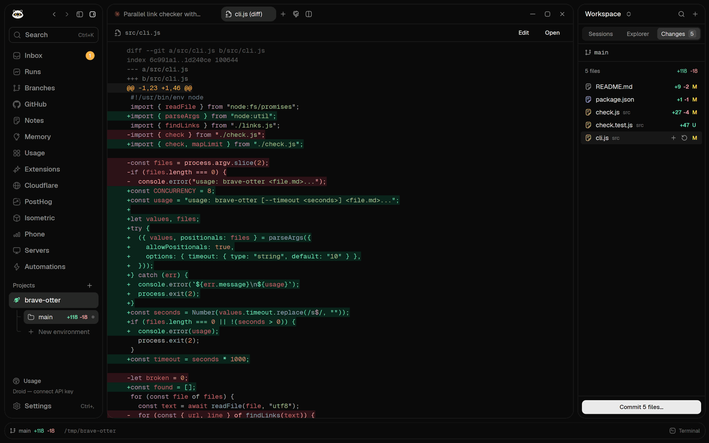
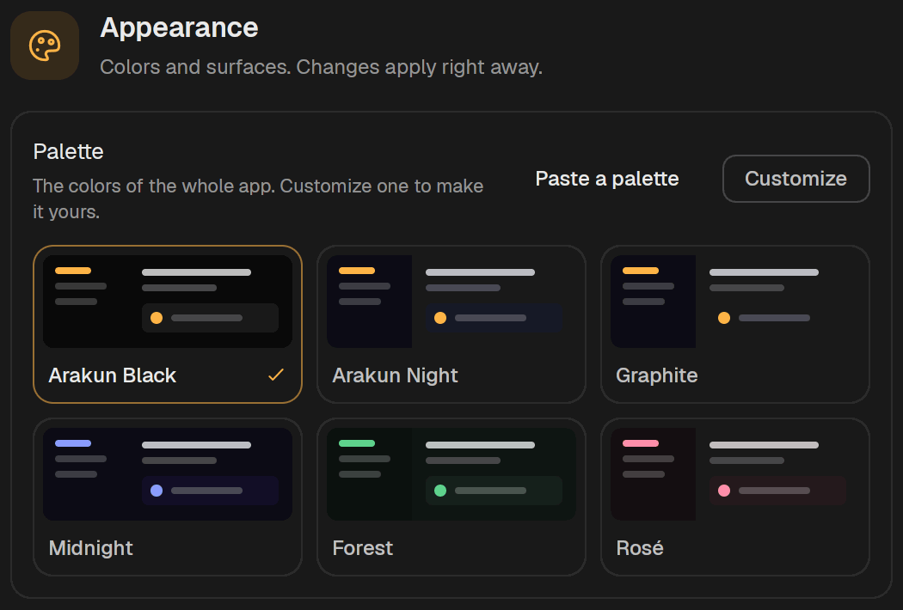

# Features

What Arakun does, view by view. The [README](../README.md) has the short list.

## First launch

Before you have a project, Arakun checks the machine for agents and GitHub, then walks
you through four short steps while a small copy of the window beside them changes as
you pick: the agent new sessions start with, your first project, the color scheme and
sidebar layout, and GitHub, the phone remote and crash reports. Enter goes to the next
step, and on the last one it finishes the setup. Esc goes back one step; on the first
step of a setup opened again, it closes it. Every step can be skipped, and "Skip setup"
leaves it at once. It ends on the start screen of the project
you added, with three shortcuts worth knowing. Open it again with "Show onboarding" in
the palette (`Ctrl+K`).

If Arakun can't read one of its files in its [data folder](storage-and-env.md) (`state.json`, `settings.json`, `history.json`,
`prompts.json`, the palette's to-dos, rules and pins, the sidebar layout or a memory
store), say one written by a newer version or edited by hand, it renames it to
`<name>.corrupt-<time>` and starts that part fresh, with a notice that says so. Nothing
saves over the copy. To restore it, quit Arakun first (it saves on quit), keep a second
copy of it, rename it back, and start a version that can read it.

## Workspace

- **Sessions in the sidebar.** With Focused (Settings › Appearance › Tabs and sessions;
  a new install starts on it), the sidebar lists every session of every project, under
  its project, archived ones aside (the archived toggle shows them). Each row has a mark for its state: a ring while it works, `!` when it needs
  you, a cross when it failed or its checks failed, a check when its checks passed, a
  faint dot when idle. The end of the row says what wants you, or the pull request's
  number. By default a project with nothing running folds (Settings can keep it open or
  hide it); the project on screen and
  any project with a session that works or needs you stay open. Click a project to
  fold or open it. `Ctrl`+click or `Shift`+click picks rows, as described below. This
  list takes the place of the Active list and the project's worktrees below. A state
  file from before it keeps the projects and worktrees described next (the Classic
  layout).
- **Pinned tabs.** With sessions in the sidebar, the title bar holds only the
  sessions pinned to it, from any project, each with its state's mark and its project's
  icon, plus the tab on screen and pages, files and views as before. Pin a session by
  dragging its row up to the bar (a line marks where it lands), with Pin to the title
  bar in its row's right-click menu, or with `Alt+P` while the pointer is on its row;
  `Alt+P` on the bar pins or unpins the tab on screen. Closing a pinned tab (`Ctrl+W`)
  or dragging it back to the sidebar unpins it; the session stays in the tree. A
  session opened from the tree without a pin shows in the bar while it is on screen.
  With nothing pinned, the session you open pins itself. Tabs keep clear of the island
  when the window fills the screen, shrink when the bar fills, and the rest go under
  **N more**, which can also unpin the ones that are done. With the sidebar hidden, a
  **Sessions** button with the count of sessions that need you opens the tree as a
  menu with a search. A state file from before pins keeps every open session pinned.
- **Active.** The top of the sidebar lists the sessions of every project that need
  you (waiting for an answer, or failed), then the ones running. A click opens the
  session in its project. It stays the same whichever project is open. The open
  project's list below holds the rest, so nothing shows twice. Move or remove it from
  Customize › Sidebar.
- **One session, one worktree.** **New session** at the top of the sidebar's list, or
  `Ctrl+T`, opens a composer at once and gives the session its own worktree on a random
  branch when you send the first prompt, which names the branch. An open worktree is used only while it has no session yet; `Alt`+click
  on New session asks for the branch. A prompt written in the main checkout, such as on
  a project's start screen, starts its session in a new worktree too, on a server as here (a server that runs
  an older Arakun, or a folder there that is no repository, starts it where it was
  written). The sidebar lists each worktree by its session's title.
  The main checkout is listed only while it holds older sessions; open it from the
  project's right-click menu (Open main checkout, one per machine). Before a
  repository's first commit there is nothing to branch from, so sessions start in
  the main checkout.
- **Several at once.** `Ctrl`+click (`Cmd`+click on macOS) rows of the sidebar's list
  to pick them, and `Shift`+click to pick a run of them. In the Active list, either
  picks the session's worktree. A bar under them settles their
  sessions, closes them (their tabs close and idle agents stop; the worktrees stay), or
  deletes the worktrees after one question, those on a server too: each server
  deletes its own. Branches stay, and so does the main checkout. `Esc` clears the pick.
- **Projects and worktrees.** A rail of projects, each with its environments (the main
  checkout plus git worktrees). The default sidebar shows the open project, with the
  others in its dropdown, and its sessions as a flat list: a status dot, the title,
  and one signal (Needs you, CI failed, Changes requested, Conflicts, or the diff).
  An environment needs you when a session asks something, when a session finished a
  turn you haven't opened yet, when CI on its branch fails, or when its pull request
  has changes requested or conflicts; CI that is still going shows it as running. If
  you take the Active list out, **Other projects** under them lists the environments
  elsewhere that run or need you. The dropdown says the same per project. The **+** on
  the Projects heading opens **New**: a session in the open project or another one, or
  a project to add (`Ctrl+T` and `Ctrl+O` pick them). `Ctrl+Shift+N` always makes a new
  worktree at once on a random branch from origin's default branch (usually `main`),
  fetched first, or from the project's **Base branch** set in Settings › Project. When
  origin has no such branch it starts from the local one, else the local commit; on a
  server, from that server's checkout, with no fetch. New environment with options…
  (`Ctrl+Alt+N`, in the palette) asks for the branch and where to start from, the local commit among them. Every environment
  has its own sessions, terminals and draft prompt. The window has one row of tabs for
  all of them: a session, file, diff or browser tab belongs to its environment, and
  going to the tab shows that environment. Going to an environment shows the tab it
  showed last. With tabs of several environments open, each run of tabs starts with
  its environment's name. The Workspace panel shows Sessions, an Explorer and the
  uncommitted
  Changes; the Branches tab shows the default branch's history, newest first, with up
  to three branches as colored lanes beside it (more fold into a list above it). Point
  at a commit, or move to it with the arrow keys, to see its author and agent, what it
  changed and its pull request. A click or Enter on a commit of a branch opens that
  branch.
  In the Commit changes dialog, "Write with <agent>" writes the message from what
  the commit takes (the staged changes, or every change, new files too, when nothing
  is staged; up to 60,000 characters of diff and the first 300 files) in the style of
  the last commit subjects. As in the pull request dialog, only the agent of the
  environment's latest session (with no session yet, the agent its next one would use)
  gets the diff: when it isn't set up, no other agent is asked and the dialog says why.
  You edit the message before you commit. Closing the dialog while it writes stops the
  agent.

  
- **Add or clone a project.** "Add project" (`Ctrl+O`) searches the git repositories
  in your home folder, or browses a path you type (`~/code/`). Paste a clone URL
  (`https://github.com/o/r`, `git@host:o/r.git`, a `gh repo clone o/r` or `git clone …`
  line) or type a GitHub `o/r` to clone it and add it in one step. GitHub repositories
  are cloned with `gh` when it is installed, so private ones use its sign-in. The clone
  goes in the folder that already holds most of your repositories, or `~/code`.
  With a server connected, the picker also offers to clone the URL on that server,
  with its git and logins. The new folder opens in its project once the server has it.
  Each project gets its own 8×8 pixel-art icon, drawn from its path. "Edit icon…" in
  the project's menu lets you draw it pixel by pixel (mirrored or not), shuffle a new
  one, start from a classic drawing, or change its color.
- **Branch names from the task.** A new environment starts on a random branch name
  (`env/brave-otter`); after the first prompt, a small model names it after the task
  (`fix/terminal-tab-name`) and Arakun renames the branch. The folder keeps its name. By
  default the agent the prompt went to names it, when that is Claude Code (with `haiku`)
  or Droid, so the prompt goes nowhere else; other agents leave the name alone.
  Settings › Branches can pick Claude Code or Droid for every environment, or turn naming
  off.
- **Archive.** Right-click an environment in the sidebar and pick Archive (or pick
  several rows and use the bar's archive button): its sessions that aren't working stop
  asking for you and leave the lists, the open review threads of its branch's pull
  request are resolved on GitHub, and that pull request's notifications are marked read.
  A session's own right-click menu archives just that session, without touching
  GitHub. An "N archived" row at the end of the sidebar's list (and "N archived
  sessions" under the Sessions list) shows them again, a search finds them, and Restore
  on the right-click menu or a new prompt brings one back. Agents that are idle and not
  open in a tab stop.
- **Archived after merge.** Once an environment's pull request is merged (Arakun asks
  `gh` every few minutes), it is archived the same way: its open review threads are
  resolved, its notifications are marked read, and the environment's sessions from
  before the merge are archived. The GitHub tab
  also marks read the notifications of every merged pull request it reads. Each merge is
  archived once, within a week of it; threads that fail to resolve are tried again at the
  next few checks. On by default; turn off Settings › Branches › Archive after merge.
- **Old environments removed.** Settings › Branches › Remove old environments (Off, 7, 14
  or 30 days) removes an environment's worktree once its
  pull request is merged or closed and it sat unused that long. Arakun checks every hour,
  asking `git` and `gh`. An environment stays when it has uncommitted or untracked files,
  git-ignored files other than build output (`target/`, `node_modules/` and the like),
  a commit that isn't in the pull request, an agent working or waiting for you, an
  automation that is on and runs in it, or is the one on screen. The branch is kept. Off by default; the first time an environment
  would have gone, a notice suggests it once.
- **Terminals.** A dock of terminals per environment (alacritty_terminal; ConPTY on
  Windows), numbered so agents and scripts can read them with `arakun logs`.
- **Running servers.** While a local server runs in one of your projects, the status
  bar says how many do and the memory they hold (**2 running · 780 MB**). A click
  lists them by project: the port, the command, who started it (a dock terminal, an
  agent, or something outside Arakun whose folder is in an environment), its memory
  and how long it has run. Under the pointer a row can open the port in the browser,
  show its terminal or stop it. Stopping ends that process and what it started,
  never the terminal's shell or the agent. The **Running** piece (Customize ›
  Sidebar) opens the same list from the sidebar, with the count on its icon.
- **Built-in browser.** Browser tabs based on CEF (Chromium Embedded Framework). Agents can drive pages on localhost with `arakun page`, and links you click open in a
  tab. See [Browser tabs](browser.md).

## Agents

| Agent | How Arakun runs it |
|---|---|
| Claude Code | Through the ACP adapter `@agentclientprotocol/claude-agent-acp` |
| Droid | Factory's `droid` CLI |
| OpenCode | The `opencode` CLI |
| Codex | Through the ACP adapter `@agentclientprotocol/codex-acp`, which brings its own `codex` |
| Devin | The `devin` CLI (`devin acp`) |
| Cursor | The Cursor CLI (`cursor-agent acp`) |
| Antigravity | Google's `agy` CLI (`agy acp`) |
| Cloudflare Workers AI | A tool loop Arakun runs itself against the Workers AI API |

The Claude Code adapter runs the Claude Code binary bundled with it (the `claude` on
your `PATH` only when that one is missing; `CLAUDE_CODE_EXECUTABLE` picks another), so
its version can differ from the `claude` in your terminal. It loads your user, project
and local settings, so your skills, hooks, plugins, MCP servers, `CLAUDE.md` and
permission rules work as they do in the terminal. It leaves out commands that only make
sense in the terminal app: `/clear`, `/cost`, `/keybindings-help`, `/login`, `/logout`,
`/output-style:new`, `/release-notes`, `/todos` and others Claude Code marks as
terminal-only. The status line and keybindings from your settings don't apply in Arakun.

Workers AI reads the project's `AGENTS.md` (or `CLAUDE.md`) and can use skills: a
folder with a `SKILL.md` in `~/.claude/skills`, `~/.agents/skills`, the project's
`.claude/skills` or `.agents/skills`, or a Claude Code plugin you turned on. Its system
prompt lists each skill's name and description, and the agent loads a skill's
instructions when a task matches it or when you type `/<name>`. A skill in your home
folder wins over a project skill with the same name. A headless session's sandbox only
sees the project's skills.

- **Agent sessions.** Transcripts render markdown, diffs, tool calls and images;
  sessions can be resumed, and per-turn diffs show what each turn changed, including
  changes made by shell commands (files over 1 MB are left out). Each transcript is kept
  in `sessions/` in Arakun's data folder until you delete the session or remove its
  environment or project, which deletes it at once. At startup, Arakun also deletes the
  files of a session its state has not listed for a week, such as one whose worktree was
  removed outside Arakun. It keeps the sessions it has seen in `state.json.seen`, next to
  the state file (the `ARAKUN_STATE` file when that is set), and never deletes a file
  whose session it hasn't seen listed. A headless session keeps its file while its folder
  under `headless/` in Arakun's data folder is there.
- **Project check.** A per-project command (`cargo test`, `npm test`...) runs after each
  turn that edits files; on failure the tail of the output goes back to the agent, up to
  three times in a row. Checks run one at a time across all sessions, at low priority and
  with half the cores for builds (`CARGO_BUILD_JOBS`), so several agents finishing
  together don't stall the computer. Set it, and the setup script new environments run,
  in Settings › Project or the project's menu. Arakun also notices when an agent loops (the same
  failing command or the same edit over and over) and offers to stop and rethink.
- **Memory.** Agents save what they learn (`arakun mem`), and every new session starts
  with an index of it in the system prompt. Plain JSON files, one per repository plus a
  global one. `arakun mem scripts` lists the scripts agents wrote again and again in a
  project's sessions, worth keeping as a script of the project.
- **Secrets on a card.** When an agent needs something only you can give, such as a
  login, an API token, a PIN or a pairing code, it asks with a card in the session
  instead of a message. The card shows what it is, why the agent needs it and, when
  there is one, the page to sign in or make it. Its inputs are masked (the eye shows
  what you typed, and nothing copies out of them), and **Save** or **Decline**
  answers. The agent gets a `secret-ref:` handle per field, never the value, and the
  transcript records only whether you saved, declined or the request was cancelled.
  A request is cancelled when you stop the run, send a new message, the turn ends,
  or 10 minutes pass. Claude Code, Codex and Droid sessions on this computer have it
  through Arakun's MCP server (`arakun mcp`, which Arakun starts for each session);
  the phone and sessions on a server don't show the card yet. Saved values wait in
  the keyring for 24 hours or until a handle is used. Only Arakun's own tool
  `run_with_secrets` redeems a handle: it sets the value as an environment variable
  for one command and masks it in the output. A handle works once, in the project it
  was made for, and Arakun won't type one into a page or a terminal. For a command
  that must read the value itself (`sudo -S`, a pairing CLI), the agent asks for a
  file instead: the card says the agent's commands can read it, and the value goes
  to a file only you can read in `secret-files` in the data folder. `secret_to_file` moves a secret you pasted in a message
  to such a file. Files are deleted after 24 hours.
- **Saved secrets.** Turn on **Save for this project** on a card, and give it a name,
  to keep the secret for the project's later sessions too. The project's entry in
  Arakun's state keeps only the name; the value stays in the keyring. Agents call
  `list_saved_secrets` for the names (never the values) and `use_saved_secret` for a
  fresh `secret-ref:` handle, which works once like any other, or with
  `deliver: "file"` for a private file. A card with several fields saves each as
  "name (field)". Settings › Project › Saved secrets lists them, masked, to rename,
  replace or remove; no screen shows a stored value. **Variable** there sets one as
  an environment variable (such as `STRIPE_KEY`) that the project's agents start
  with, sandboxed or not, so tools that read it work without the value passing
  through the chat. The agent's commands can read it, as they can a file.

- **SSH in a session (Linux and macOS).** To use a build machine from a local
  agent session without installing Arakun there, open **Connect SSH** in that
  session. Sandboxed sessions can't use it: it would lend them your local SSH
  agent. Enter the literal `user@host` and port. Compare the ED25519
  fingerprint with one you got from the machine's administrator or console
  before trusting it. The account needs a key already loaded in your local
  `ssh-agent`; Arakun uses system OpenSSH, without SSH config aliases, password
  prompts or agent forwarding. The remote account's permissions apply.

  Tell the agent about the connection to let it suggest a command. Review
  the exact command and run it once, or enter one yourself. Each run starts a
  fresh non-interactive shell: a `cd` doesn't carry over. A run is limited
  to 10 minutes and 64 KiB of combined output. Output stays in
  the panel unless you share it with that session. Disconnect cancels the
  local SSH client and forgets the connection; it cannot undo a command or
  guarantee that a process on the remote machine stops. Connections are not
  saved across restarts. The panel is not a boundary: an agent that isn't
  sandboxed runs as you and can reach your `ssh-agent` without it. Sandbox the
  project to keep your SSH keys from the agent.
- **Headless and sandboxed agents.** `arakun agent run` starts an agent that keeps going
  with the app closed, and Sandbox agents keeps a project's agents away from your
  logins and secret files. See [Headless and sandboxed agents](headless.md).
- **Server.** `arakun server` is Arakun without a window, for a machine nobody sits at:
  a build box, the workstation at the office, a VPS. See [Server](server.md).

### What each agent needs

Arakun does not bundle the agents. Each needs:

- Claude Code: Node.js with `npm` (Arakun installs the ACP adapter in
  `~/.local/share/arakun/agents`, or `%LOCALAPPDATA%\arakun\agents` on Windows) and a `claude`
  that is signed in or set up with an API key or another endpoint (`ANTHROPIC_BASE_URL`,
  such as a gateway or CLIProxyAPI) in `~/.claude/settings.json` or the environment.
- Droid: Factory's `droid` CLI.
- OpenCode: the `opencode` CLI, signed in with `opencode auth login`.
- Codex: Node.js with `npm` (Arakun installs the ACP adapter in
  `~/.local/share/arakun/agents/codex`, or `%LOCALAPPDATA%\arakun\agents\codex` on
  Windows) and a Codex sign-in: `codex login` with your ChatGPT plan (Settings › Codex
  runs it for you), or `CODEX_API_KEY` or `OPENAI_API_KEY` in the environment.
  `ARAKUN_CODEX_ACP` runs another adapter command instead.
- Devin: the [Devin CLI](https://docs.devin.ai/work-with-devin/devin-cli), signed in
  with `devin auth login` (Settings › Devin runs it for you) or `WINDSURF_API_KEY` in
  the environment. Arakun starts `devin acp`; `ARAKUN_DEVIN_BIN` picks another `devin`
  and `ARAKUN_DEVIN_ACP` runs another command instead.
- Cursor: the [Cursor CLI](https://cursor.com/docs/cli/installation), signed in with
  `cursor-agent login` (Settings › Cursor runs it for you) or `CURSOR_API_KEY` in the
  environment. Arakun starts `cursor-agent acp`; `ARAKUN_CURSOR_BIN` picks another
  `cursor-agent` and `ARAKUN_CURSOR_ACP` runs another command instead. Cursor sessions
  use the MCP servers in `~/.cursor/mcp.json` and the project's `.cursor/mcp.json`.
- Antigravity: Google's [Antigravity CLI](https://antigravity.google/docs/install?tab=cli)
  1.5 or later, signed in with Google (Settings › Antigravity runs `agy acp --login` for
  you) or with `GEMINI_API_KEY` set up in agy. Arakun starts `agy acp`; `ARAKUN_AGY_BIN`
  picks another `agy` and `ARAKUN_ANTIGRAVITY_ACP` runs another command instead.
- Workers AI: a Cloudflare API token with Workers AI access, either stored through
  `opencode auth login` or set as `CLOUDFLARE_API_TOKEN` and `CLOUDFLARE_ACCOUNT_ID`.

The first session with Claude Code or Codex asks before it installs the adapter, and shows
the package, the folder and the npm command, so you can run it yourself instead. Once an
adapter is installed, Arakun updates it to the pinned version without asking.
`ARAKUN_CLAUDE_ACP` and `ARAKUN_CODEX_ACP` start another adapter instead.

## GitHub

- **CI and checks.** GitHub Actions runs for each project, with jobs, annotations and
  the failing log, read through the `gh` CLI.
- **Create a pull request.** The pull request chip of the Changes panel opens the
  branch's pull request, or a dialog that creates one: the title (from the first
  commit), the branch it merges into (the remote's default one; type another for a
  stack), and the description GitHub's own form would start with (the repository's
  pull request template, else the commit messages). It opens as a draft unless you turn
  that off, pushes the branch first when it has commits GitHub doesn't, and then shows
  the new pull request in the GitHub tab. "Open GitHub's form" opens the page in your
  browser instead, to write the description there. "Write with <agent>" has the agent
  of the environment's latest session (after "Continue with", the one it went on with;
  with no session yet, the agent its next one would use) write the title and the description from the branch's commits, its diff (up to 60,000
  characters) and the template. Only that agent gets the diff, since you already chose
  that provider for this code: when it isn't set up here, no other agent is asked, not
  even the one picked for naming branches, the description stays the template or the
  commit messages, and the dialog says why. The button names the agent, so you see where
  the diff goes before you click. It answers once, in an empty folder, with as little reach as its CLI allows: Claude Code, OpenCode and
  Workers AI with no tools, Codex in a read-only sandbox without its shell or your Codex
  config, Droid with `droid exec` (read-only), Cursor in ask mode and Devin in its
  default mode, which only reads.
  Nothing goes to GitHub until you create the pull request.
- **Queue.** The GitHub tab opens on one line that says how many things need you,
  then a quiet list grouped by where each pull request stands (Needs you, Stuck,
  pilot is on it, Waiting on CI, Waiting on others, Ready to merge), stacked pull
  requests under their base, and what was merged today folded at the bottom. With
  arakun-pilot (below) the list is its board; without it, the review queue: pull
  requests whose review is asked of you, mentions and assignments, your own open pull
  requests, the open issues assigned to you ("Assigned issues"), what is ready to merge
  and what was done today, read from your notifications and searches through the `gh`
  CLI and its session. It opens before you add a project too.
- **Pull request sheet.** A row opens a sheet on the right with where the pull request
  stands, who has it, what comes next, the checks and the stack, then tabs for what
  pilot did, the conversation, checks and files. On a window under 1000 pixels tall the
  details fold to one line (status, checks, review and merge) so the tabs keep the room;
  "All details" (`D`) unfolds them and "Fewer details" folds them again, and the choice
  stays for the next pull request. The box at the bottom comments (Enter
  or "Comment"), and says why when a comment doesn't go out. Approve, request changes
  and merge ask a second time, and an approval or a merge stops if new commits came
  after you looked.
- **Agent fixes.** When a pull request conflicts with its base branch, "Fix conflicts"
  starts a session that merges the base in (no rebase), settles the conflicts, runs the
  tests and commits the merge. When it has open review threads, "Address N comments"
  starts a session with those threads (CodeRabbit's too): the agent fixes each one or
  says why not, and lists a reply per thread for you to post. Neither pushes, replies
  or resolves anything on GitHub. In the box, `/conflicts` and `/comments` do the same.
- **Failed checks.** When checks failed, the Checks tab says how many, and a failed
  GitHub Actions job opens the end of its failing step's log under its row (the link at
  the end of the row opens its page). "Re-run failed" starts the failed jobs again
  (`gh run rerun --failed`) once their run has finished. "Fix with agent" starts a
  session with the failed checks and the logs you opened; the agent fixes it in the
  checkout and doesn't push.
- **Review comments.** Under each thread on the diff, "Reply" answers it and "Resolve"
  (or "Reopen") marks it. In the Files tab, the open threads show under their lines,
  and a click on a line writes a comment on it. Those comments are kept as pending
  (only until you quit) and "Submit review" posts them together as one review;
  "Discard" drops them. After new commits, submit or discard the pending ones before
  you comment on the new diff.
- **Agent reviews.** An agent can review a pull request for you and leave a draft
  (`arakun github draft`) that you post, edit or discard. Posting a draft asks a second
  time, and an approval goes out only for the commit the agent read: after new commits
  the draft can only be posted as a comment.
- **Issues.** An issue's sheet has "Work on it with agent" (a session that makes the
  change in the open project, and leaves git and GitHub to you), "Close issue" and, on
  a closed one, "Reopen issue"; both ask a second time. In the box, `/work`, `/close`
  and `/reopen` do the same.
- **Alerts and filters.** A pending review request alerts once per pull request.
  New activity in the thread does not ask for the same review again. Mentions,
  assignments and other activity from watched repositories still alert as before. Click the
  repository line above the verdict to show only some organizations or repositories; the rest
  doesn't show, count or alert. "Mark all read" marks only what that choice shows.
- **Pull request agent.** Connect arakun-pilot, a pull request agent on a server of
  your own, and its board fills the queue. See [arakun-pilot](github-pilot.md).

<details>
<summary>When the GitHub tab reads GitHub, and what it stores</summary>

Arakun reads GitHub in the background only after you open the tab once, and stops while
`gh` is missing or signed out. It keeps the watch list, the filter choice, the comment order and whether you
opened the tab, the review drafts, and the profile pictures it shows (each downloaded
again after a week) in its [data folder](storage-and-env.md).

</details>

## Stay in the loop

- **Dynamic Island** (Linux on Wayland, macOS and Windows). A small overlay at the top of
  the screen that shows what the agents of every project are doing: a dot per busy
  session, a card when one finishes, fails or needs an answer. It runs as its own process
  (`arakun island-host`). On Linux it needs a compositor with the wlr-layer-shell
  protocol. On Windows it sits at the top center of the main screen; see
  [docs/windows.md](windows.md). There it also shows agents that run outside
  Arakun, such as Claude Code in another terminal: their hooks call
  `arakun island hook`, and any other agent can use `arakun island session <id> <state>`.
  The setup is in docs/windows.md. On a MacBook it grows out of the notch, or out of
  the screen's own Dynamic Island on the models that have one, and sits on the built-in
  screen. On a Mac without
  either it hangs from the top of the main screen. Turning it off in Settings ends that
  process. If it reads the cutout wrong, set
  `ARAKUN_ISLAND_EDGE` to `flat`, `notch:<width>x<height>` or
  `pill:<width>x<height>+<gap to the top>`, in points.
- **Keep running in the background** (Linux). Off by default; turn it on in Settings ›
  General. Closing the window then hides it instead of quitting, so agents, terminals and
  the island go on. On Hyprland the window waits in the special workspace `arakun`, on
  Sway in the scratchpad, and elsewhere it is minimized. Run `arakun` (or `arakun show`,
  or open it from the app launcher) to bring it back, and `arakun quit` to quit.
  A desktop other than Hyprland and Sway may not raise a minimized window when asked
  (GNOME and KDE on Wayland can refuse); click Arakun in the dock or task bar then.
- **Notice history.** Every notice Arakun shows (on the island or as a desktop
  notification) also lands in the sidebar's Inbox, under the sessions waiting on you,
  grouped by day. Click one to open what it is about. The Inbox is the button at the end
  of the search box when it sits next to Search in the sidebar (as in every preset), and
  a row of its own anywhere else. Its badge counts the unread ones (9+ past nine); they
  count as read when you close it. Arakun keeps the last 300. `arakun notices [--unseen]` prints them.
- **Phone remote.** A web page served by Arakun lets a paired phone follow sessions, send
  prompts and answer the agent. While the agent works, a prompt you send waits for the
  turn to end; with something written, Stop becomes "Stop and send". Phones reach the
  computer over the local network (the default), over Tailscale, or through an
  end-to-end encrypted relay. On the local network and over Tailscale the page comes
  from the computer itself, so it only opens while the computer is on and awake; the
  relay works from anywhere and says when the computer is offline (the Phone tab says so and offers Use Relay).
  Every way is end-to-end encrypted between the phone and the computer. The computer
  signs each handshake with its own key, the phone checks it is the key it was paired
  with, and every message after that is sealed with AES-256-GCM. On the local network
  and over Tailscale the pairing link carries the key's label (`?p=<code>&k=<label>`);
  a phone that types the code instead keeps the key that answers then. The code, the
  device token, the sessions and the notification settings all go inside that channel.
  Plain HTTP only carries the page itself. So someone on the same Wi-Fi who listens
  reads nothing. Someone who can change the traffic could still change the page: for
  that, use Tailscale (the page comes over HTTPS) or the relay. On the local network the
  page has no WebCrypto (the browser keeps it to HTTPS pages), so it uses a JavaScript
  copy of the same algorithms. The page keeps its token in `localStorage`, and over
  HTTPS in a cookie too, for the iOS home-screen app; the page must read it to send it
  inside the channel. The relay defaults
  to the hosted one at `app.arakun.dev`, and lets a device in only when it is signed in
  to the same account as the computer. With Relay chosen, the Phone tab says "Sign in
  to reach this computer from anywhere" until you press **Sign in** (the
  same sign-in as the User row; no Teams needed). Signed in, it shows your login, the
  address to open on the phone with its QR code, and **Signed-in devices**: every
  device signed in to the account, with its kind and when it was last used, and
  **Sign out** for each but this computer; and **Your computers**: the account's
  computers that run the app, online or when last seen, with **Remove** for each but
  this computer (it asks first, by name). A computer still signed in comes back the
  next time it connects. **New identity** removes this computer's old entry from the
  account before the new key connects; if that fails, a notice says it is still
  listed. A device signed out elsewhere is dropped here with its notifications, and so
  is every device of the account when you sign out or change accounts; devices paired
  on the network stay. There is no code to pair through the relay.
  The first time a device connects, a notice says "<name> connected for the first
  time"; `phone.json` keeps it by its signed-in device's id and name, with no token,
  and the account that let those devices in (`relay_account`, its GitHub id): signed
  out, or under another account, they are dropped. **Paired phones** lists only the
  phones paired here with a code.
  On the phone, open `https://app.arakun.dev`,
  sign in with GitHub or with a code emailed to you, and pick the computer (with one,
  the page opens it straight away).
  Each computer in the list has **Remove**, and the page's Settings tab lists the
  account's signed-in devices with **Sign out**. A device unpaired in the Phone tab
  goes back to the list and does not connect again by itself. With several computers,
  push notifications on the page come only from the computer opened last: a browser
  keeps one subscription per site. The iOS and Android apps reach your computers the
  same way, only by signing in with GitHub; they have no link or code for the relay.
  They are in beta: under **Phone app beta**, signed in, type the email to invite
  (your Apple ID for iOS, your Google account for Android; it starts as your GitHub
  email) and press **Join the iOS beta** or **Join the Android beta**. Testers are
  added by hand, so the row says you signed up until the TestFlight or Google Play
  invite is on its way, then that you are in. **Change email** fixes the address
  while you wait.
  The Android app gets notices from every computer it has opened while they are on.
  A computer sends a phone a notice only when you are away from it: by default, after
  2 minutes without using it. A permission request or a question waits until you
  leave, and goes only if the agent still waits. A turn shorter than 30 seconds sends
  no notice. Change both under **Only when I'm away for** and **Turns shorter than
  this stay quiet**: in the page's Settings tab, in Settings in the iOS app's inbox
  menu, or in Account in the Android app's inbox menu. The bell in a session mutes
  that session's notices on the phone.
  In the iOS and Android apps, the count of changed files on top of a session opens
  the files it changed, turn by turn, and each file its diff, read-only, as on the page.
  Anyone who signs in to your GitHub account, or holds one of its sessions, can reach
  every computer of the account: sign out what you do not know. A message from the
  service's operator to your account shows as a notice with its link; opening it or
  putting it away on the island marks it read.
  You can run your own from [`cloud/`](../cloud)
  (a Cloudflare Worker): `relay_base` in `phone.json` and `ARAKUN_TEAMS_URL` must
  name the same server. Arakun sends your session only to the server that issued it,
  so when the two differ the relay stays signed out and the Phone tab names both
  addresses. A server in the Computers tab added under another account server is kept
  but not connected, for the same reason. A
  `relay_base` of `https://arakun.dev`, the old default, reads as the new one.
  The page keeps shortcuts, phrases you send often, as a row of buttons over the box.
  One that sends right away shows while the agent waits for you; the others show while
  you write and fill the box. `{number}` in a shortcut is a blank you type each time,
  on the number keyboard. Hold a message you sent to keep it, or tap **+** in the row.
  Shortcuts stay in that phone's browser.
  Charts and diagrams in a reply (` ```chart ` and ` ```mermaid ` blocks) are drawn
  on the phone as they are in the app. **Code** shows the block's text, and **Open**
  shows the drawing full screen.

## More tabs

- **Service tabs.** A PostHog tab (personal API keys; matches projects by their `phc_`
  keys) and a Cloudflare tab (uses the `cf` CLI's sign-in). The PostHog tab has
  Overview, Events (filter by event, `key = value` properties, a person and a range;
  a row opens its properties, its person and its replay), People (search by email or
  distinct_id; a profile with properties, cohorts, flags, sessions and a timeline),
  Flags, Experiments, Errors and Ask. A flag, experiment or error opens inside the
  tab. **Fix with agent** on an error and **Set up with agent** put a prompt in the
  composer without sending it. Ask sends a question to PostHog AI, not to your
  coding agent, and shows its answer and the SQL behind it; a pinned answer is a
  saved copy and is not asked again. The key needs `user:read`, `organization:read`,
  `project:read`, `query:read`, `feature_flag:read`, `experiment:read` and
  `error_tracking:read`; People also needs `person:read` and `cohort:read`, the
  event picker `event_definition:read` and `property_definition:read`, and Ask
  `insight:read`. A tab whose scope is missing says which one and the others keep
  working. PostHog counts queries per hour: the tab shows how many are left, keeps
  each account's answers on disk (cleared when its key is replaced or removed) and
  reads again only when they are 15 minutes old or you refresh.
  Changing something in PostHog always asks you to type the flag key first. On a
  flag, stage enable or disable (or a 10% rollout step, for release conditions in
  PostHog's classic format), then review it; it needs `feature_flag:write`, and
  PostHog refuses it if someone else changed the flag since. On a running experiment, **End experiment** freezes its results and leaves
  the flag as it is; **Ship**, offered only for a variant the results call a
  winner, also gives that variant to everyone the flag already matches. Both need
  `experiment:write`. To try the tab without a key (Linux and macOS), start a test
  Arakun with
  `ARAKUN_POSTHOG_FIXTURE="$PWD/tools/posthog-fixture.json" arakun dev start`.
- **Linear.** The open [Linear](https://linear.app) issues assigned to you, grouped
  by state (in progress, todo, backlog) with their identifier, title, team and
  priority, and a search box over them. Sign in with a personal API key (Linear ›
  Settings › Security & access › Personal API keys; read access is enough). Add one
  sign-in per workspace; the header switches between them. The keys are kept in the
  system keyring, and who signed in in the data folder. A key goes to Linear's
  API; if you let Linear start sessions on this computer, it also goes to Arakun, to
  prove the Linear user is you. The tab reads the list again when it is 5 minutes old or you refresh (at most every 30 seconds), and waits as
  long as Linear asks when it hits Linear's request limit, saying how many minutes
  are left. A click on an issue (or
  `↑`/`↓` and `Enter`; `/` goes to the search box) opens it with its description and
  comments. **Work on it with agent** starts an agent session in the open project
  with the issue's identifier, title, description, comments and link. It leaves git
  and Linear to you: the agent is asked not to commit, push, open a pull request or
  touch the issue. **Open in Linear** opens the issue in a browser tab (in your
  browser when no project is open). To try the tab without a key (Linux and
  macOS), start a test Arakun with
  `ARAKUN_LINEAR_FIXTURE="$PWD/tools/linear-fixture.json" arakun dev start`.
  An Arakun account with the `linear` flag also sees **Start from Linear** in the
  header, a page that lets Linear start sessions on this computer. The feature is
  still behind the `linear` flag. The server side is turned on by the operator (see
  `cloud/README.md`), and only after an app release with this feature is out.

  *Setting it up.* The switch **Let Linear start sessions on this computer** is off
  until you turn it on. It needs an Arakun sign-in, "Reach this computer from
  anywhere" on in the Phone tab, and Arakun installed in the Linear workspace by a
  Linear admin (the page links to the install). **Add a mapping** sends a Linear
  team or project of the workspace to a project on this computer, or to the main
  folder of a repository on one of your paired servers (shown as "app on box"). A
  Linear project's mapping wins over its team's.

  *On a server.* A mapping to a server's project runs there, not here, so it works
  while this computer is off. Arakun sends that server its own mappings, the switch,
  and the Linear key of each mapped workspace you connected, over the server's
  end-to-end encrypted link, whenever they change and whenever the server connects.
  The server keeps them in its folder and tells Arakun's server what it takes (see
  "Issues delegated in Linear" under the server). Removing the last mapping, or
  turning the switch off, sends the server empty settings, and it forgets the key.
  The server needs its own sign-in to the same account and the relay. A server too
  old for this says so in the Computers tab.

  *What starts.* When you assign an issue to Arakun in Linear, or mention Arakun on
  it, Arakun's server hands the issue to this computer. The computer checks that the
  switch is on, that the issue (read with your own Linear key) is in a mapped team
  or project, and that the mapped project is still in Arakun on this computer. Then
  it makes an environment on the issue's branch in that project, or reuses the one
  already on that branch, without changing what is on screen. The branch is
  Linear's suggested name, made safe for git, or `linear/<issue id>` (for example
  `linear/eng-412`) when that name can't be used or is a default branch such as
  `main`. A session never runs in the project's main checkout or on its base
  branch. The session uses the project's usual agent, model and permission mode.
  Its prompt is built from the issue: the title, description and comments, marked
  as data. It ends by asking the agent to commit, push and open a draft pull
  request that names the issue. Anyone who can write in the issue or its
  comments, integrations included, can steer a session that commits and pushes
  under your permission mode; map only projects where you accept that. A
  session started from Linear shows its issue's identifier before its title in the
  sidebar and the Inbox.

  *Who can start what.* Anyone who can assign issues to Arakun in the workspace
  only starts work on their own computer: the server routes by who delegated the
  issue. One gap: a Linear automation that delegates an issue assigned to you is
  treated as you, because Linear does not tell a person from an automation. Text
  that other people wrote in the issue becomes part of the agent's prompt, marked
  as data.

  *How many.* At most three such sessions work at once on a computer, unless you
  choose another number (1 to 10) under **Sessions at once** in the Linear tab. Each
  paired server has its own number there. A session waiting on your answer, or on
  work it left running in the background, does not count. More wait in a
  saved queue and start, in the order they came, as others finish. The issue hears
  how many are running and how many wait before it. A queued issue
  is read again when it starts, so its text may have changed since you delegated
  it. A reply you send in Linear while it waits is kept (up to eight) and the
  issue hears `Kept your message. The session on {computer} gets it when it
  starts.`; Arakun keeps only which message it was, and reads its text from
  Linear when the session starts.

  *What the issue hears.* Arakun writes to the issue as the work goes:
  `Started in {project} on {computer}, on the branch {branch}.`; when it waits,
  `Waiting on {computer}: {n} other sessions from Linear are running. This one
  starts when one finishes.`; a question from the session, with its choices to
  pick from when it is one question with one answer and two to ten short
  choices (a pick reaches the session as if you had typed it), and otherwise
  with its choices one per line; `Waiting for your permission: run a command. Answer it in Arakun or on
  your phone.` (only the kind of action, never the command or file; a permission
  is never answered from Linear); the result; the pull request's link, added to the
  session in Linear as soon as Arakun knows it, also after the result; `The session failed: {reason}` on a failure; and `Still working.`
  after 25 quiet minutes. While the session works, the issue also shows the step it
  is on, shown as Linear shows a tool call: Editing `src/main.rs`, Reading `README.md`,
  Running a command or Searching the code. It holds only the kind of step and, for a file, its path in the
  project, never a command, a search or a web address. A step shows until the next
  activity replaces it. Next to it, the issue keeps a note of what the agent said
  before its steps and the steps it finished, such as Edited `src/main.rs` or
  Ran 3 commands, so the work stays readable after it moves on. The agent's thinking
  and its final reply are not in it. At most one step and one note go every 30 seconds. When the agent keeps
  a plan (its to-do list), the session in Linear shows it as a checklist at its
  top: each item's text, with secrets taken out and cut to 300 characters, and
  whether it is pending, in progress or done. The whole plan goes again when it
  changes, at most every 15 seconds, and at once when the turn ends or waits on
  you. Linear keeps the last plan when a later turn has none. If you close Arakun
  while a session runs, the issue hears `Arakun was closed on {computer} while this ran. Reply here to continue.`

  *Talking to the session.* A reply in Linear from the person who delegated goes to
  the session as a new message, and the issue hears at once that it was passed on
  and what it waits behind (the current turn, a permission or a secret), so Linear
  does not show the agent as starting. Arakun does not take a reply's text from
  its server: it reads it from Linear with your own key, and if that fails the
  issue asks you to send it again. With the switch off, or without a Linear sign-in for the
  workspace on this computer, a reply is refused and the issue hears why. A reply
  waits in the session's queue when the agent is busy, and it never answers a
  permission prompt. A reply while a question is pending skips the question and
  sends the reply, unless the question asks for a secret. A reply to a finished session continues it, unless another
  session from Linear is working on the same issue by then. To interrupt instead,
  start the reply with `!` (or `/interrupt`), as in `! Use the other API.`: the
  turn at work is cancelled, the rest of the reply goes to the session as the next
  message, the run goes on, and the issue hears `Interrupted the session on
  {computer}. It works on your new message now.` A reply that is only the marker
  changes nothing. A stop in Linear cancels the turn and ends the run. So does
  taking the work back in Linear: unassigning Arakun (by anyone), canceling the
  issue or marking it a duplicate, a person marking it done, or removing Arakun's
  access to the team or the workspace. The issue hears why, as in `Stopped: Arakun
  was unassigned.`; a run that had already ended hears nothing. A stop that
  arrives while a reply or a new delegation for the same issue is still being read is applied after the work it follows. A stop
  works even with the switch off, or when this computer is no longer signed in to
  that Linear workspace.

  *When nothing starts.* Each case gets a line in the issue that says why: the
  switch is off, the issue is not mapped, the mapped project is gone, this computer
  has no Linear sign-in for the workspace, the issue can't be read, an environment
  can't be made, or the same issue is already in work on this computer. If this
  computer is off, the server says so in the issue and keeps the delivery for up to
  7 days; it starts when the computer is back. A reply or a stop sent while this
  computer is off is kept the same way, and the issue hears that it waits.

  *What goes where.* The Linear key of each workspace you connect goes to Arakun's
  server, to prove which Linear user you are, and the server does not store it. You
  connect the workspace in view by turning the switch on, and another workspace
  with its **Connect** button while the switch is on. Its key is sent once the
  workspace has a mapping, and again only if the server loses the link. A server
  with a mapping to its project gets the key too, and keeps it. Otherwise
  only the relay label of this computer, the Linear organization id of the
  workspace and the ids of its mapped teams and projects go for the setup. Once a
  session runs, what the issue hears goes through Arakun's server to the issue:
  the session's last reply (up to 7,500 characters, code included, with secrets
  scrubbed), its questions and their choices, the kind of a permission it waits
  for (never its arguments), the kind of step it is on and the path of the file
  it works on, the project name, the branch, this computer's name
  and the reason of a failure. The server stores none of it. Turning it off removes
  this computer's routes on the server and leaves the link, so your other computers
  keep working. Until you turn it on nothing about Linear is sent, except that an
  account with the flag asks the server whether Arakun is installed in the
  workspace. Arakun keeps the switch and the mappings (ids, names and project paths,
  no keys) with the workspaces you connected, and the servers that hold Linear
  settings, so one whose last mapping went is told to forget them. It also keeps the
  runs: which deliveries were handled, each run with its ids, paths, the issue's identifier and state, and the
  reports not yet sent. Those reports hold text and are dropped after a day.
  Arakun updates the server when you change the page, add or remove a Linear
  sign-in, sign in to Arakun, or add or remove a mapped project, and when this
  computer reconnects to the relay; there is no timer. A report that can't be sent
  is kept and tried again later, and never holds up a session. The server's side is
  in `cloud/README.md`.
- **Doop.** The canvases of a [Doop](https://doop.design) instance and the frames
  of the one you pick, page by page, each with its render; a click opens the frame on
  the canvas in a browser tab. Sign in with the browser, or paste an agent key (the form offers the one
  in `DOOP_KEY` or `~/.config/arakun/doop_key`). The form signs in to Doop
  (doop.design), or to a self-hosted instance when you pick Self-hosted and type its
  address. Plain `http://` is only taken for an instance on this machine or a private
  network, and then the key or token crosses that network unencrypted; use `https://`
  unless you trust every device on it. Every sign-in stays saved, and the header
  switches between them; the keys and tokens are in the system keyring. The
  tab reads through the instance's MCP endpoint (`<instance>/mcp`), so a canvas an
  instance doesn't list can be added by its link.
  Accounts › Agents adds that MCP server
  to Claude Code or Droid (as `doop`, or `doop-<host>` for a self-hosted instance), so
  sessions can read and draw on the same canvases.
- **Usage.** Token use and estimated API cost from Claude Code's and Droid's own logs,
  and Devin's local SQLite session history, including sessions run outside Arakun.
  Devin's history is read only from `$XDG_DATA_HOME/devin/cli/sessions.db` (by default
  `~/.local/share/devin/cli/sessions.db`), or `sessions.db` in `DEVIN_SESSIONS_DIR`.
  Repeated responses are counted once. Models without a known API price are shown
  as unpriced, not as free. Billed ACUs and experimental file-based session history
  are not imported yet.
  Arakun also shows Claude Code, Droid, OpenCode and Devin plan limits. Devin's daily
  and weekly quota (Max has only the weekly one) comes from the endpoint the devin
  CLI's `/usage` reads. It is not a documented API, so it can stop working after a
  Devin update; then the quota is left out. Plans billed in credits or ACUs show none.
  Arakun has no account of its own and never asks you to approve access: it
  reads the limits with the sign-in each CLI already has (Claude Code, droid,
  OpenCode, devin), and Sign in runs the CLI's own login. Devin's key goes only to
  server.codeium.com, the server `devin auth login` signed in with. It only reads that sign-in and
  never changes it. It sends it only to that provider's own host over https, never to
  a gateway set in `ANTHROPIC_BASE_URL`. Droid can also use a Factory API key you
  connect in Arakun (kept in the system keyring) or `FACTORY_API_KEY`, which goes only
  to api.factory.ai. When Claude Code runs on CLIProxyAPI, add the proxy's management key in the
  tab to see the 5-hour and weekly limits of every Claude and Codex account behind it,
  how many still have room, and which ones the proxy holds back (cooling down, or
  signed out). For a proxy Claude Code does not run on, use Add CLIProxyAPI (or Change
  address) and type its address. Refresh reads the accounts now; Change key and
  Forget key replace or remove the key. The key is only sent to the proxy it was added
  for, over https or to this machine. It is kept in the system keyring; a key an
  older Arakun saved in a file moves to the keyring the next time the tab reads.
- **Claude seats.** With several Claude subscriptions, give each Claude Code session a
  seat of its own so parallel sessions don't drain one. Save each subscription's
  long-lived token (from `claude setup-token`) with `arakun seat add <name>`: it is read
  from stdin, checked with one small call (about 35 tokens of that seat) and kept in
  the system keyring, with an empty file in `seats/` in the data folder that lists
  the seat. A token an older Arakun saved in that file moves to the keyring the first
  time it is read. From then on each new Claude Code session starts on the seat with
  the most room in its 5-hour window that
  is not near its 5-hour or weekly limit (your own sign-in and a
  `CLAUDE_CODE_OAUTH_TOKEN` Arakun was started with count as seats too), and keeps
  that seat for its whole life, also when it is resumed or restarted. The token goes
  only into that session's environment; there is no proxy. If every seat is near its
  limit, the session starts on the one with the most room and says so. The composer
  shows the seat of the session, and the Usage tab every seat's windows and live
  sessions. Reading a token's windows sends that seat a one-token message, so Arakun
  reads the windows only while the Usage tab is on screen, for `arakun seat ls`, and
  when a new session picks its seat (waiting at most 4 seconds), at most every 15
  minutes per token. Starting a session on a saved seat also checks its token with that
  message (waiting at most 10 seconds) unless the same token was read in the last
  minute, so a dead token shows up at the start, not in the middle of a session. A seat whose
  token is refused is skipped, and a session saved on it moves to another seat and says
  so. A session also keeps a SHA-256 fingerprint of its seat's token (never the token),
  so it says so when a different token was saved under the same name. Sessions in the
  sandbox don't use seats: they run on Claude Code's default account, and one that was
  on a seat says so. Seats can't work
  while `~/.claude/settings.json` sets `CLAUDE_CODE_OAUTH_TOKEN` in its `env` block,
  because Claude Code applies that over each session's environment; the Usage tab says
  so, sessions start as before, and one that was on a seat says so. The same goes
  while Claude Code runs on an API key, a gateway or a cloud provider, which win over
  any seat's token. Without a saved seat nothing changes.
- **Marketplace.** Plugins, MCP servers and skills to add, and the MCP servers, plugins,
  skills and permission rules the agents load now. Discover › Skills searches
  [skills.sh](https://skills.sh); Install copies the skill's folder from its GitHub
  repository into `~/.claude/skills`, where Claude Code and Workers AI find it, or into
  the repo's `.claude/skills` when "Install in" (below) picks this repo. A repository
  with several skills is a package: a skill's details offer "Install all" for every skill
  in its repository, and typing `owner/repo` or a GitHub link in the search box lists the
  skills of that repository, also one skills.sh does not know. Skills you have already
  stay as they are. It uses
  your `gh` sign-in (or `GH_TOKEN`) when there is one, since GitHub answers few
  requests without one. "Install in" picks where Install puts a plugin, skill or MCP
  server on this computer: every repo (your user), this repo shared (its committed
  `.claude/settings.json`, `.mcp.json` or `.claude/skills`), or this repo just for you
  (Claude Code's `local` scope; a skill goes in `.claude/skills` and is listed in
  `.git/info/exclude`). An MCP server that signs in gets the repo in its name when it is
  installed in a repo (`github-acme-web` in acme/web), so each repo has its own sign-in. Paired servers
  get what you install by the mirror (see [Server](server.md)). Under Arakun › Extensions (or Settings ›
  General › Sidebar) you turn on the tabs the sidebar shows besides Inbox, Runs, Branches and Marketplace: GitHub, Notes,
  Memory, Usage, Cloudflare, PostHog, Linear, Doop, Isometric, Phone, Computers and Automations. The
  palette and Customize › Sidebar list only the tabs that are on. A new install starts
  with none on, except what you set up in the first-run setup: GitHub once the GitHub
  CLI is signed in, and Phone if you chose to pair one. An update keeps the ones your
  sidebar already had.
- **Sidebar groups.** A segment with a title folds with a click on it, and opens
  folded next time. Folded, it says how many pieces it holds, with a dot when one of
  them wants you (red for a failure or something waiting), so the projects get the
  room. Right-click a title for Ungroup, which removes the segment and keeps its
  pieces in the one above. In Customize › Sidebar, a segment can be set to start
  folded or not to say what is inside; a new one is born titled and collapsible.
- **Isometric.** Animated isometric scenes: the project's `iso/*.rhai` scripts, then
  the starters that ship with Arakun. New scene asks what to draw and starts a session
  that writes it as a new file in `iso/`; Change starts a session that edits the scene
  on screen. A starter is copied into `iso/` first. The tab shows each save as the
  agent writes it. Export PNG, Export SVG and Export animated SVG save the scene in
  the look on screen: a 1600 px wide frame, one frame, or the whole loop.
  Agents in any project read the guide with `arakun iso docs` and the shipped scenes
  with `arakun iso example [name]`.
- **Automations.** Scheduled shell commands or agent prompts per project.
- **Teams.** A pilot, only for the accounts it is turned on for; the agents and the
  rest of Arakun never need it. Click the User row of the sidebar (or Settings ›
  Account) for the Profile dialog. **Sign in** there opens a dialog that asks how:
  **Continue with GitHub**, or an email address. With an address, Arakun asks the
  server to mail a six-digit code, which you type in the dialog; it works once, for 10
  minutes, and **Send a new code** mails another. An address with no account yet makes
  one, or joins the account whose verified GitHub address it is. With GitHub, the
  dialog shows a code and opens GitHub's device page:
  enter the code there and approve. The dialog counts down the code's 15 minutes and
  says when it ran out or GitHub turned it down, with a way to get a new one. Arakun
  asks GitHub only to read your email addresses (`user:email`) and hands the token once
  to the server. The server does not keep that token: it stores your GitHub user name
  and ID, your primary verified email address (so the operator can reach you about your
  account; the only mail it sends is a sign-in code you ask for), and a hash of each session with the name and kind of
  the device it is on. A server other than the default (`ARAKUN_TEAMS_URL`) names its
  own GitHub app, which Arakun asks it for. Arakun drops the GitHub token and keeps the
  session the server answers with in the system keyring: the Keychain on macOS, the
  Credential Manager on Windows, and the Secret Service (gnome-keyring, KWallet or
  KeePassXC) on Linux (without one, the session lasts until Arakun quits). Signed in, the User row shows
  your GitHub picture and "Signed in with GitHub", or your address and "Signed in by
  email". An account the server has turned
  Teams on for gets a **Team** row under Search in the sidebar; any other account is
  signed in all the same, but cannot use Teams. A Team tab left open from
  before says Teams is not on for the account. Sign out (in the Profile dialog) removes
  the session from the keyring, then asks the server to end it; if the server can't be
  reached, the session there stays valid until it expires (90 days without renewal,
  180 days after sign-in at most). `ARAKUN_TEAMS_URL` points Arakun at another Teams
  server, such as one run with `wrangler dev` (see
  [cloud/README.md](../cloud/README.md)); the default is `https://app.arakun.dev`, and
  plain `http://` works only for `localhost`, `127.0.0.1` and `[::1]`. Each server
  keeps its own session in the keyring, so signing in to a local server leaves the one
  for `app.arakun.dev` alone.

  The Team tab is an end-to-end encrypted team chat. Each account on this
  profile has its own device key pairs in the system keyring. Messages and
  channel names are sealed on the device, and the server never sees them or the
  team keys. It does see team names, who is in which team and with which role,
  device names, invites, and who sent a message when and how large it was (see
  [cloud/PROTOCOL.md](../cloud/PROTOCOL.md)). With no team yet it offers **Start a team**,
  which makes one with a `general` channel. A channel shows the team's channels
  (**+** adds one) and people on the left, and the chat with a composer at the bottom.
  A channel's row counts the messages from others you have not read there, up to
  "99+"; a message counts as read once its channel is on screen. On a new device the
  count starts at the newest message of each channel. Under **Here now**
  the people who have this channel open come first, with a green dot. Channels
  Arakun only reads, for **Decisions** or because you were there earlier, do not
  count.
  Click the team's name for your other teams, **Start a team** and **Your devices**;
  "N invites" at the top opens invites to other teams; click the people at the top
  right for the team's page, which invites people by GitHub login and removes members.
  An owner's **Change role** on a person makes them an owner, an admin or a member;
  **Hand over** makes them an owner and you an admin. A team always keeps an owner, so
  its only owner can't leave or step down until someone else is one.
  **Withdraw** takes back an invite nobody answered yet. An invite you got shows with
  **Accept** and **Decline**; after you accept, the waiting page has **Remind**, which
  tells the team's admins once an hour at most. "N waiting" at the top opens the people
  who accepted an invite, each device with its code: approving hands the team key to all
  their devices, from yours, only if every device's endorsement chain checks out; one
  that doesn't blocks the approval. It doesn't wait for **Compare**, but a device marked
  as not matching is refused. The server still
  supplies the membership and roles; it is not an independent proof of who belongs to
  the team. Removing someone rotates the key for the remaining members, not messages
  already seen. Hover a message and press the reply arrow to answer it: the quote
  shows above your message, and clicking it scrolls to the original. **Esc** drops the
  reply. To edit a message of yours, hover it and press the pencil, or press `Up` in
  an empty composer for your last one; `Enter` sends the edit, **Esc** drops it, and
  the message then ends with "(edited)". An edit or a decision the server refuses
  says why, with **Send again**.
  Messages whose signature does not check out are hidden and counted. The **+**
  of the composer (files) is not there yet.

  **@bot** reviews a discussion and proposes a decision. Reply to the first message
  it should read and write `@bot` (or press the composer's **@bot**): the messages
  from that one down to yours light up, and a line over the composer says how many it
  will read. A plain `@bot`, with no reply, reads only your message. It runs on your
  own Claude Code (the `claude` CLI and its login), on your machine, read-only: it may
  read the open project's code and docs and search the web, and nothing else. It reads
  a private copy of the project without what git ignores and without files that look
  like secrets (`.env*`, `.dev.vars`, `*.pem`, `*.key` and other key stores, `id_*`,
  credential files such as `.netrc`, `.npmrc`, `.pgpass`, `kubeconfig`,
  `credentials.json` and a service account's JSON key, Terraform state and
  variables, and anything under `.ssh/`, `.gnupg/`, `.aws/`, `.kube/`, `.azure/` or
  `.config/gcloud/`) and without files that are not text, which the answer counts
  under what it could not check. Keys, tokens and passwords in the files it does
  read and in its answer are replaced with `[redacted]` before it is posted. To
  answer, Claude Code sends the messages and the code it reads to its model service
  (Anthropic, or the one you set it up with), as any Claude Code session does; the
  Teams server still sees only sealed messages. What it searches the web for leaves
  your machine too, to the search service. It writes those searches itself, so a
  message, a file or a web page written to steer it could put text from the project
  in one: don't ask it with a project open whose text must not get out. The answer
  ends with every search it made, or says it made none, so the team can see what
  left. A long range is summed up in parts
  first, and the answer says so. The answer judges each
  idea (Works, Works with conditions, Won't work) with numbered citations that jump to
  the message, lists what it verified in code, docs or on the web, what it assumed and
  what it could not check, and ends with a **Proposed decision**. It is headed with whose Claude Code
  wrote it, such as "karlo's Claude Code": the answer is that member's message, run
  on their machine, and Arakun cannot check that a run wrote it or what it read.
  Trust it as you trust the member. **Accept decision**
  tells the team; **Reject** marks it on this device only, and the team is not told; **Ask for more detail**
  starts a reply to it. While it runs, the chat shows its progress and **Stop**; if
  it fails, **Try again**. Once someone accepts, the channel says "Decided." and who
  accepted it. A member can take an accepted decision back: open it in Decisions and
  press **Reverse it**, with a reason if you like. The channel then says "Reversed."
  with who and why, and the **Reversed** filter of Decisions shows only those.
  **Decisions**, at the top of a channel, lists what the team accepted,
  with who accepted it and when, the messages it came from (click to jump there) and
  what @bot checked; search it, or show only yours.

  **Pair two agents for a review.** Open the same channel and a local project on
  both devices. Each member types `/agents pair @other-login` to lend one Claude
  Code turn; the offer stays open for 15 minutes. Either can then type `/agents review <goal>`:
  the other agent reviews the goal, and the asking member's agent reads those
  notes and posts a recommendation. Everyone in the channel sees the exchange. The model provider
  receives the goal and relevant notes, not the channel history or local files.
  Each CLI call has no tools, one turn and a USD 0.10 budget. `/agents off`
  cancels this device's participation; restarting or disconnecting does not
  renew it. Pair again for a new review. A review cannot approve a decision,
  edit a project, run a command or deploy anything.

  An agent already working in that environment can use the same grant:
  `arakun peer-review "Review the proposed rollback steps"` waits and prints
  the recommendation. The command cannot pair a device or select a different
  channel or project. A peer that stops being available says so in the channel
  and the command ends then. If the peer disconnects without a word, the
  command gives up after 5 minutes. Use `/agents off` locally to stop waiting sooner.
  Treat the reply as peer feedback, not new permissions.

  **Encrypted**, at the top of a channel, says what the server sees and what it
  can't. When a member adds a device, the chat says "@them added a new device" where
  it happened, with **Compare**: both devices show six groups of five digits, made
  from both keys of each of the two devices. Read them to each other; **They match**
  marks the device checked on this device only (kept in the keys file below).
  **They don't** is kept too: that person gets no team key from this device until a
  later comparison matches, and this device makes no new team key while they are in
  the team (compare again, or remove them).

  A second device of yours shows "Approve this device from your other device" and a
  code: on a device that already has Teams, click the team's name › **Your devices**
  (or **Your devices** at the top, on a device not in a team yet) and paste it. The
  team keys and trusted device roots are kept in `teams-<account>-<scope>.keys` next
  to the state, sealed with a key from the keyring. The scope identifies the server
  and profile. A lost cache can recover only the key envelopes the server still has
  for this device, not its local trust records. Signing out discards unsent drafts.
  A test Arakun with its own `ARAKUN_STATE` (such as `arakun dev`) keeps its own
  Teams session, device and keys. With `ARAKUN_TEAMS_FIXTURE` (a stand-in account
  for testing), `ARAKUN_TEAMS_FIXTURE_SIGN_IN=ok`, `expired` or `denied` starts
  signed out and plays the sign-in dialog to that end without GitHub.

## Make it yours

How the app looks is changed in the **Customize** panel, at the right of the window where
the workspace panel is, so the work stays in view while you change it. Open it from the
palette (`Customize`), the View menu on macOS or Settings › Appearance › Open Customize, which
only sums up what is chosen. It opens without a project too.

Settings › Appearance › Tabs and sessions sets where sessions and tabs show. Three
presets set everything at once: **Focused** (sessions in the sidebar tree, pinned tabs
in the title bar; a new install starts here), **Classic** (every open tab in one row,
the sidebar with projects and worktrees, as before) and **Everything** (the tree and
every open tab). A state file from before this setting opens on Classic, so nobody's
window changes after an update; pick Focused to switch. Then each option can change:
Sessions live in (Sidebar, Title bar, Both), Title bar shows (Pinned, This project, All
open), State (Icon, Dot, Word), Group by project, Sort sessions (Recent, Name,
Manual), Projects with nothing running (Open, Folded, Hidden), Long titles (Cut, Two
lines) and Sidebar width. Sort sessions starts on Recent, the session that moved last
on top of its project, or of the whole tree without project headings, whether its
agent or you moved it. Sessions pinned to the title bar go first in every order, with
a pin at the end of the row and a rule under them. Recent and Name put the sessions
with a tab open next, a rule under them; a session with no tab open is dimmed. Manual is the order you drag the
sessions into within each project, kept for each project in `state.json`; dragging a
session onto another switches its project to Manual from the order on screen. The rows
hold still while the pointer is over the tree. The sort button in the tree's heading
says the order in use and opens a menu to pick another, with Group by project and Show
archived; its Applies to gives the order to every project, or with Select projects… to
the projects ticked in a list beside it, the rest keeping the order for all. Each
project's own order is kept in `state.json` too. Options that mean nothing with the others are off: with sessions only in the title bar there is nothing
to pin from or fold. Moving to pinned tabs pins every open session first. The choice is
kept in `state.json` as `tabs`.

Settings › Appearance › Reduce motion holds the mascot, spinners and the island still (its
working dots, its change of shape and its alert cards), and shows menus and dialogs
without sliding them in. System (the default)
follows macOS's Reduce motion, GNOME's Animations switch or Windows' Animation effects,
and picks up a change when Arakun's window comes to the front; On and Off ignore the
system. The choice is kept in `state.json` as `reduce_motion`.

- **Colors.** Mode draws the color scheme on black or on a white background with dark text.
  There are built-in color schemes (Arakun Black, the default, then Calma, Arakun Night,
  Graphite, Midnight, Forest, Rosé). Only the center of the window is a sheet; the
  sidebar, the workspace panel and the status line sit on the window itself, and the
  accent is kept for what needs you. Duplicate one to change its tint, background and
  accent; Arakun warns when text or the accent gets hard to read. Grays sets how bright
  secondary text and borders are, and Diff colors how added and removed lines look, with a
  few lines of a diff under it to see the choice. Contrast follows the system's high
  contrast setting (macOS Increase contrast, Windows high contrast, GNOME's high contrast
  theme), or is set to Standard or High: High raises secondary text to 7:1 and borders
  to 3:1, whatever Grays says, and turns Glass off.
  Reset colors goes back to Arakun Black, dark, and keeps your color schemes.

  
- **Shape.** Corners makes cards, buttons and fields sharper or rounder (0 to 200%;
  presets Sharp, Default, Round). Spacing makes the room inside and between things
  tighter or roomier (60 to 160%; Compact, Default, Roomy). Window gap is the space
  around and between the sidebar, the main area, the panel and the dock (0 to 20 px;
  None, Default, Wide). The defaults (100%, 100%, 8 px) look as before and are kept in
  `palettes.json` too. Text size and Glass are here as well. Reset shape goes back to
  the defaults.
- **Sidebar.** Start from a preset (Switcher, Focused, Developer, Notion, Icons,
  Everything); it lays out the pieces and keeps the style you chose. Every preset holds
  the User row, where you sign in; a layout saved without it gets it once,
  next to Help. Style (Card, Flush,
  Floating), Rows, Width, Side, what Ctrl+B does, Counters and Shortcuts change the whole
  sidebar. While this tab is open the sidebar is being arranged: it shows in full,
  every segment opens as a list with its outline and title, and a click on a piece or a title selects it instead of
  opening it. The tab then shows its options (name, emoji, folding, Fixed or Scroll,
  Ungroup, remove) and chips to add a group, a link, a command, a title, a separator,
  a spacer or what the sidebar does not hold yet, into the selected segment with a
  click (with nothing selected, into the segment that holds the most views), and selects what it added. The pieces among them (not Group, Link, Command or Title, which ask for more
  first) can also be dragged onto the sidebar where they should go. Pieces and segment
  titles drag into another order on the sidebar itself. The panel's header has undo
  and redo for these changes; what is typed into one field is one step. Done closes the panel, and "Customize sidebar…" in the
  palette or the sidebar's right-click menu opens this tab. After that menu hides a piece, ungroups
  or removes a segment, a note at the foot of the sidebar says so for ten seconds, with an Undo button; it stays while the pointer is on it. Reset sidebar goes back to the default
  layout and width.
- **Share a look.** Export… at the foot of the panel, on any tab, copies the colors,
  the shape or the sidebar, the ones you tick, as one line (`arakun:look/v1:…`).
  Import reads a look line and asks again which parts to use; the sidebar is off until
  ticked, since it replaces the whole layout. A sidebar layout comes without its
  commands, which run on a click: add those with Command…, where their text can be
  read. Import also takes a color scheme line (`arakun:palette/v1:…`) or a sidebar layout
  copied before looks existed.
- **Design system.** The card at the foot of the panel opens the Design system tab:
  every color, type style and component, live, so a change can be judged on all of
  them at once.

## Token use from the command line

Turns of Workers AI sessions also log what each tool's results added to the context.
`arakun usage tools [--days N] [--json]` adds them up, largest first, with bash split by
the program the command runs (`bash cargo`, `bash git`), so you can see which tools and
commands cost the tokens.

`arakun usage where [--days N] [--json]` reads the Claude Code transcripts on this
computer (`~/.claude/projects`) and shows where their tokens go: the setup that loads
with every message (skills, plugins, MCP servers, `CLAUDE.md` files, hook output) and
which of it no session called, each project's first-message size, how full sessions
got, and the noisiest tool results. It lists what to fix first, largest first, with one
suggestion each. The last 30 days count by default (`--days 0` for all). Every number
is an estimate, at about 4 bytes a token. It only reads the files: nothing is sent
anywhere and your setup is not changed. The Usage tab shows the same findings under
Breakdown, as "Where tokens go", each with a button that opens the file, or the
Marketplace tab's installed MCP servers, plugins or skills, where you change it.
